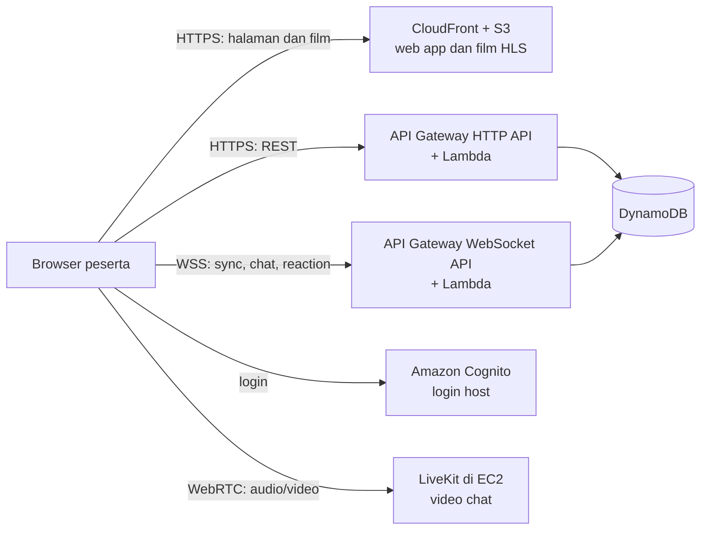

# Product Requirements Document (PRD) — Watch Party

## Platform Nonton Film Bareng Tersinkronisasi dengan Video Chat Real-Time di AWS

> **Catatan nama produk:** Nama produk masih nama kerja; difiksasi Senin 2 Nov 2026 (kandidat: "Watch Party" atau "Cinema"). Semua identifier teknis diturunkan dari satu variabel Terraform `project_name` (placeholder `watchparty`), sehingga rename cukup dengan search-and-replace. Nama file dokumen ini sengaja tidak ikut diganti agar permalink tetap stabil.

| Atribut | Nilai |
|---|---|
| Versi dokumen | **2.0-rc (menuju freeze prd-v1.0)** |
| Tanggal | 31 Oktober 2026 |
| Status | Release candidate, belum di-freeze |
| Pemilik dokumen | Product & Tech Lead (TBD) |
| Tim | 6 anggota, role belum di-assign (lihat §11) |
| Draft sebelumnya | [archive/PRD-watch-party-v0-draft.md](archive/PRD-watch-party-v0-draft.md) |

> **Aturan isi PRD:** PRD ini hanya berisi hal yang stabil, yaitu *apa* yang dibangun dan *kenapa*. Detail yang mudah berubah (versi software, konfigurasi service, skema pesan, estimasi biaya) ada di [architecture.md](architecture.md), [adr/](adr/README.md), dan [contracts/](contracts/). Dengan begitu PRD tidak perlu direvisi saat detail implementasi berubah.

---

## Daftar Isi

1. [Ringkasan](#1-ringkasan)
2. [Latar Belakang & Masalah](#2-latar-belakang--masalah)
3. [Tujuan & Sasaran Terukur](#3-tujuan--sasaran-terukur)
4. [Scope & Non-Goals](#4-scope--non-goals)
5. [Personas](#5-personas)
6. [Fitur](#6-fitur)
7. [User Stories & Acceptance Criteria](#7-user-stories--acceptance-criteria)
8. [Non-Functional Requirements](#8-non-functional-requirements-nfr)
9. [Constraints](#9-constraints)
10. [Arsitektur Logis (Ringkas)](#10-arsitektur-logis-ringkas)
11. [Roles & Ownership](#11-roles--ownership)
12. [Milestones](#12-milestones)
13. [Risiko & Mitigasi](#13-risiko--mitigasi)
14. [Success Metrics & SLO](#14-success-metrics--slo)
15. [Change Control](#15-change-control)
16. [Open Questions & Decision Log](#16-open-questions--decision-log)
17. [Glossary](#17-glossary)
18. [Referensi](#18-referensi)
19. [Changelog](#19-changelog)

---

## 1. Ringkasan

Watch Party adalah aplikasi web untuk menonton film bersama secara online dengan pemutaran yang tersinkron antar peserta. Di dalam satu halaman, peserta juga bisa video/audio chat, chat teks, dan mengirim emoji reaction. Host membuat room dari katalog film, membagikan link, lalu teman-temannya bisa langsung join tanpa membuat akun.

Produk ini adalah tugas mata kuliah cloud infrastructure. Dosen mengharapkan **produk jadi yang bisa diakses lewat internet**, bukan proof of concept. Seluruh infrastruktur berjalan di AWS (region Singapore, `ap-southeast-1`) dan didefinisikan dengan Terraform. Akun AWS memakai **Free plan** agar tidak ada risiko tagihan.

## 2. Latar Belakang & Masalah

- Menonton film sendirian terasa kurang sosial, terutama untuk pasangan LDR atau teman yang tinggal di kota berbeda.
- Solusi watch party yang ada sering punya latensi sinkronisasi tinggi, kualitas video buruk, atau tidak punya video chat terintegrasi, sehingga pengguna harus membuka aplikasi lain seperti Zoom atau Discord.
- Pengguna ingin pengalaman "nonton bareng di sofa" yang bisa direplikasi secara digital dengan mulus.
- Dari sisi tim, proyek ini adalah kesempatan untuk mendemonstrasikan infrastruktur cloud yang nyata: CDN, API serverless, WebSocket real-time, server media, DNS, TLS, IaC, observability, dan kontrol biaya.

## 3. Tujuan & Sasaran Terukur

### 3.1 Tujuan Produk

- **G1.** Peserta bisa menonton film yang sama secara tersinkron dengan selisih posisi kecil (target p95 < 500 ms).
- **G2.** Peserta bisa saling melihat dan mendengar lewat video chat langsung di halaman yang sama.
- **G3.** Peserta bisa join hanya dengan link dan display name, tanpa install aplikasi dan tanpa akun.
- **G4.** Produk bisa diakses publik lewat HTTPS di custom domain, dengan biaya tetap di dalam Free plan.

### 3.2 Sasaran Terukur (v1.0)

Semua sasaran punya metode pengukuran di [§8](#8-non-functional-requirements-nfr) dan [§14](#14-success-metrics--slo).

| ID | Sasaran | Target |
|---|---|---|
| T-1 | Latensi sinkronisasi (command propagation dan drift) | p95 < 500 ms |
| T-2 | Join-to-first-frame | p95 < 3 s |
| T-3 | Page load (LCP halaman utama) | < 2 s |
| T-4 | Peserta per room | 10 peserta dengan video chat aktif |
| T-5 | Skala demo | 1 room aktif |
| T-6 | Ketersediaan API (REST + WebSocket) | ≥ 99% request non-5xx |
| T-7 | Biaya | Tidak ada tagihan (Free plan); pemakaian credits ≤ budget bulanan |

> Latensi audio/video chat (< 300 ms) adalah **target dependency** dari LiveKit dan jaringan peserta, bukan SLA tim. Angka ini dipantau tetapi tidak menjadi syarat rilis (lihat NFR-1.6).

## 4. Scope & Non-Goals

### 4.1 In Scope (v1.0 dan v1.1)

- Web app (desktop dan tablet) untuk membuat room, join via link, menonton film tersinkron, video chat, chat teks, dan emoji reaction.
- Katalog film **curated** berisi film berlisensi Creative Commons (Blender open movies: *Big Buck Bunny*, *Sintel*, *Tears of Steel*), dikelola hanya oleh admin tim.
- Login host dengan Amazon Cognito; guest join secara anonim dengan display name.
- Infrastruktur AWS lengkap via Terraform, custom domain HTTPS, monitoring, dan budget alarm.

### 4.2 Non-Goals / Won't (v1)

| Item | Alasan |
|---|---|
| Recording sesi video chat | Biaya storage, isu privasi, tidak dibutuhkan untuk tujuan G1–G4 |
| Fitur "raise hand" | Nilai kecil untuk room ≤ 10 orang |
| Upload film oleh pengguna | Risiko hak cipta dan biaya transcoding; katalog curated cukup |
| Native mobile apps | Di luar waktu 7 hari; web app mendukung tablet |
| Embed YouTube | Tidak bisa dikontrol untuk sinkronisasi presisi dan tidak mendemonstrasikan media pipeline sendiri |
| Multi-region / high availability lintas region | Di luar budget Free plan dan kebutuhan skala demo |

## 5. Personas

### Persona 1: Andi (25 tahun, karyawan)
- Ingin nonton film bareng teman kampus yang sudah tersebar di berbagai kota.
- Butuh platform yang simpel, tidak ribet, dan bisa langsung jalan.

### Persona 2: Bella (20 tahun, mahasiswa LDR)
- Ingin nonton film bareng pacarnya yang berada di luar negeri.
- Butuh video call agar bisa melihat ekspresi pacarnya saat adegan penting.

### Persona 3: Community Host (organisator komunitas film)
- Ingin mengadakan nonton bareng online untuk anggota komunitas.
- Butuh kontrol sebagai host: siapa yang boleh mengatur pemutaran, mengeluarkan peserta yang mengganggu, dan menutup room.

## 6. Fitur

### 6.1 Model Peran di Dalam Room

Setiap peserta di dalam room punya satu peran. Peran ini berlaku untuk semua fitur di bawah dan dicek di server.

| Peran | Siapa | Boleh kontrol playback | Boleh grant/revoke controller | Boleh kick / tutup room |
|---|---|---|---|---|
| `host` | Pembuat room (login Cognito) | Ya | Ya | Ya (v1.1) |
| `controller` | Peserta yang diberi izin oleh host | Ya | Tidak | Tidak |
| `viewer` | Default untuk semua guest | Tidak | Tidak | Tidak |

**Aturan bisnis room:**

- **BR-1.** Secara default hanya host yang bisa play/pause/seek. Host bisa memberi (grant) dan mencabut (revoke) peran `controller` ke peserta mana pun.
- **BR-2.** Server menolak perintah playback dari `viewer`.
- **BR-3.** Setiap room punya batas peserta terhubung `maxParticipants` (termasuk host). Batas ini ditentukan saat room dibuat dan tidak berubah. Nilai default sekaligus nilai maksimum di v1 adalah 10. Angka 10 adalah batas teknis dan biaya (server video chat di satu EC2 kecil dan budget credits), bukan aturan bisnis, jadi nilainya diambil dari konfigurasi dan tidak di-hardcode (lihat [architecture.md §3.2](architecture.md#32-parameter-aplikasi)). Host boleh memilih batas lebih kecil, 2–10, saat membuat room (F-1.8). Satu tempat selalu tersedia untuk host, jadi guest terhubung maksimal `maxParticipants − 1` (default 9). Guest yang mencoba masuk saat semua tempat guest sudah terisi ditolak dengan pesan "Room penuh", walaupun host sedang offline. Aturan ini juga berlaku untuk peserta yang putus lalu reconnect setelah tempatnya terisi orang lain. Batas ini dijaga di server, termasuk saat beberapa orang join bersamaan (cara kerjanya di [architecture.md §7.4](architecture.md#74-access-patterns)).
- **BR-4.** Room otomatis berakhir (expired) 24 jam setelah dibuat. Peserta yang sedang berada di room saat itu dikeluarkan dengan pesan "Room telah berakhir" (AC-2.5.4). Di v1.1 host juga bisa menutup room secara manual.
- **BR-5.** Jika satu peserta buffering, room tidak di-pause untuk semua. Peserta tersebut otomatis mengejar posisi room setelah buffering selesai.
- **BR-6.** Setiap room punya tepat satu host, yaitu pembuat room (pengguna yang login Cognito). Peran `host` tidak bisa dipindahkan ke peserta lain.
- **BR-7.** Jika koneksi host putus (tab ditutup atau jaringan putus), room dan state playback tidak berubah. Film yang sedang diputar tetap diputar untuk semua peserta, dan film yang sedang di-pause tetap di-pause. Peran `host` tidak dipindahkan ke siapa pun. Peserta yang sudah menjadi `controller` tetap punya haknya seperti biasa. Daftar peserta menampilkan host sebagai offline. Saat host login lagi dan membuka link room, host kembali dengan peran `host` (AC-1.4.2) dan memakai tempat yang dicadangkan untuknya (BR-3). Room tetap berakhir saat masa hidup 24 jam habis (BR-4), ada atau tidak ada host.

### 6.2 Daftar Fitur

Kolom **Rilis** menunjukkan versi target: v1.0 (target 8 Nov 2026) atau v1.1 (buffer sampai 22 Nov 2026). Prioritas memakai MoSCoW: Must = v1.0, Should = v1.1.

#### F-1 Manajemen Room

| ID | Fitur | Prioritas | Rilis |
|---|---|---|---|
| F-1.1 | Host membuat room baru dengan memilih film dari katalog | Must | v1.0 |
| F-1.2 | Sistem membuat link undangan unik yang bisa dibagikan | Must | v1.0 |
| F-1.3 | Guest join via link dengan display name, tanpa login (anonim) | Must | v1.0 |
| F-1.4 | Host login dengan akun (Amazon Cognito) sebelum membuat room | Must | v1.0 |
| F-1.5 | Daftar peserta aktif beserta peran dan status player masing-masing | Must | v1.0 |
| F-1.6 | Host mengeluarkan (kick) peserta | Should | v1.1 |
| F-1.7 | Host menutup room secara manual | Should | v1.1 |
| F-1.8 | Host memilih batas peserta yang lebih kecil saat membuat room (2–10, termasuk host; default 10) | Could | — |

#### F-2 Pemutaran Tersinkronisasi

| ID | Fitur | Prioritas | Rilis |
|---|---|---|---|
| F-2.1 | Play, pause, dan seek tersinkron ke semua peserta | Must | v1.0 |
| F-2.2 | Kontrol playback default hanya host; host bisa grant/revoke peran `controller` | Must | v1.0 |
| F-2.3 | Player HLS dengan adaptive bitrate (ABR) otomatis, kontrol volume dan fullscreen lokal | Must | v1.0 |
| F-2.4 | Indikator status player: "Buffering", "Syncing", "Ready" | Must | v1.0 |
| F-2.5 | Reconnect otomatis dan resync (termasuk peserta yang join terlambat) | Must | v1.0 |
| F-2.6 | Pilihan kualitas manual (360p/480p/720p/1080p) sebagai override ABR | Should | v1.1 |

#### F-3 Video Chat Real-Time

| ID | Fitur | Prioritas | Rilis |
|---|---|---|---|
| F-3.1 | Nyalakan/matikan kamera | Must | v1.0 |
| F-3.2 | Mute/unmute mikrofon | Must | v1.0 |
| F-3.3 | Grid view video peserta (layout otomatis sampai 10 tile) | Must | v1.0 |
| F-3.4 | Indikator kualitas jaringan per peserta | Should | v1.1 |
| F-3.5 | Pilih device input (kamera dan mikrofon) | Should | v1.1 |
| F-3.6 | Opsi menyembunyikan peserta tanpa video dari grid (seperti "hide non-video participants" di Zoom) | Could | — |

#### F-4 Chat Teks & Reaksi

| ID | Fitur | Prioritas | Rilis |
|---|---|---|---|
| F-4.1 | Chat teks real-time di sidebar | Must | v1.0 |
| F-4.2 | Emoji reactions (👍 ❤️ 😂 😮 😢) yang muncul sebagai overlay di atas video | Must | v1.0 |

#### F-5 Katalog & Fitur Pendukung

| ID | Fitur | Prioritas | Rilis |
|---|---|---|---|
| F-5.1 | Daftar katalog film curated (judul, poster, durasi, lisensi) | Must | v1.0 |
| F-5.2 | Search dan filter katalog | Could | — |
| F-5.3 | Riwayat room yang pernah dibuat/dikunjungi | Could | — |
| F-5.4 | Notifikasi browser untuk event room | Could | — |
| F-5.5 | Toggle dark mode | Could | — |

#### F-6 Platform

| ID | Fitur | Prioritas | Rilis |
|---|---|---|---|
| F-6.1 | Aplikasi diakses lewat HTTPS di custom domain `<project_name>.chescloud.my.id` (contoh `watchparty.chescloud.my.id`) | Must | v1.0 |

#### Won't (v1)

Recording, raise hand, upload film oleh pengguna, native mobile apps (lihat [§4.2](#42-non-goals--wont-v1)).

### 6.3 Graceful Degradation

Video chat (F-3.x) berjalan di server terpisah dari sinkronisasi film. Jika server video chat mati, fitur F-1, F-2, F-4, dan F-5 tetap berjalan, dan UI menampilkan pesan bahwa video chat sedang tidak tersedia.

## 7. User Stories & Acceptance Criteria

Setiap fitur Must dan Should punya satu user story dengan ID yang sama nomornya (US-x.y untuk F-x.y). Acceptance criteria (AC) ditulis dalam format Given/When/Then dan harus bisa dites. Angka batas (TTL, limit, ukuran) mengacu ke [architecture.md §3 Angka Kunci](architecture.md#3-angka-kunci-single-source-of-truth) dan [contracts/](contracts/).

### Epic 1: Manajemen Room

**US-1.1 (F-1.1)** — Sebagai host, saya ingin membuat room baru dengan memilih film dari katalog agar bisa mengundang teman menonton bareng.
- **AC-1.1.1** Given host sudah login dan berada di halaman katalog, When host memilih satu film dan menekan "Buat Room", Then room baru dibuat dengan film tersebut, status playback `paused` di posisi 0, dan host masuk ke halaman room sebagai `host`.
- **AC-1.1.2** Given host belum login, When host menekan "Buat Room", Then host diarahkan ke halaman login dan tidak ada room yang dibuat.
- **AC-1.1.3** Given request pembuatan room memakai `mediaId` yang tidak ada di katalog, When request dikirim, Then API menolak dengan error `NOT_FOUND` dan tidak ada room yang dibuat.

**US-1.2 (F-1.2)** — Sebagai host, saya ingin mendapat link unik agar bisa membagikannya ke teman.
- **AC-1.2.1** Given room baru saja dibuat, When halaman room tampil, Then host melihat link undangan berformat `https://<project_name>.chescloud.my.id/r/<roomId>` dan tombol "Salin link" yang menyalin link ke clipboard.
- **AC-1.2.2** Given dua room dibuat, When link keduanya dibandingkan, Then `roomId` berbeda dan `roomId` adalah string acak minimal 12 karakter (tidak berurutan, tidak bisa ditebak).

**US-1.3 (F-1.3)** — Sebagai guest, saya ingin join via link dengan display name agar tidak perlu membuat akun.
- **AC-1.3.1** Given guest membuka link room yang aktif, When guest mengisi display name 1–32 karakter dan menekan "Join", Then guest masuk ke room sebagai `viewer` tanpa diminta login.
- **AC-1.3.2** Given guest mengisi display name kosong atau lebih dari 32 karakter, When menekan "Join", Then form menampilkan error validasi dan guest belum masuk room.
- **AC-1.3.3** Given room dengan batas default (`maxParticipants` = 10) sudah berisi 10 peserta terhubung (host + 9 guest), When orang ke-11 menekan "Join", Then join ditolak dengan pesan "Room penuh" (error `ROOM_FULL`) dan jumlah peserta terhubung tetap 10, termasuk saat beberapa orang menekan "Join" bersamaan. Aturan yang sama berlaku untuk batas lain: guest ditolak saat `maxParticipants − 1` tempat guest sudah terisi (BR-3).
- **AC-1.3.4** Given link room yang sudah expired/ditutup atau `roomId` tidak ada, When guest membuka link, Then halaman menampilkan "Room tidak tersedia" dan tidak ada form join.

**US-1.4 (F-1.4)** — Sebagai host, saya ingin login dengan akun agar room yang saya buat terhubung ke identitas saya dan saya bisa kembali sebagai host.
- **AC-1.4.1** Given pengguna belum punya akun, When pengguna mendaftar dengan email dan password lalu memverifikasi email, Then pengguna bisa login dan kembali ke aplikasi dalam keadaan login.
- **AC-1.4.2** Given host sudah membuat room lalu menutup tab, When host login lagi dan membuka link room yang sama, Then host masuk kembali dengan peran `host` (bukan `viewer`).
- **AC-1.4.3** Given pengguna login dengan password salah, When submit login, Then login gagal dan aplikasi tetap dalam keadaan belum login.

**US-1.5 (F-1.5)** — Sebagai peserta, saya ingin melihat daftar peserta aktif agar tahu siapa saja yang sedang menonton.
- **AC-1.5.1** Given saya berada di room, When peserta lain join, Then namanya muncul di daftar peserta dalam ≤ 2 detik, lengkap dengan perannya (`host`/`controller`/`viewer`).
- **AC-1.5.2** Given peserta lain menutup tab atau koneksinya putus, When server mendeteksi disconnect, Then dalam ≤ 5 detik setelah disconnect terdeteksi guest tersebut hilang dari daftar. Jika yang putus adalah host, host tidak hilang dari daftar, tetapi ditandai offline (BR-7, AC-2.5.5).
- **AC-1.5.3** Given peserta lain sedang buffering, When status player-nya berubah, Then daftar peserta menampilkan status player terbaru peserta tersebut (Buffering/Syncing/Ready).

**US-1.6 (F-1.6, Should)** — Sebagai host, saya ingin mengeluarkan peserta yang mengganggu agar suasana tetap nyaman.
- **AC-1.6.1** Given saya host dan ada peserta X di room, When saya memilih "Keluarkan" pada X dan konfirmasi, Then X keluar dari room, video chat X terputus, X melihat pesan "Anda dikeluarkan oleh host", dan X hilang dari daftar peserta semua orang.
- **AC-1.6.2** Given saya `viewer` atau `controller`, When saya mencoba memanggil API kick, Then server menolak dengan error `FORBIDDEN`.
- **AC-1.6.3** Given X sudah dikeluarkan, When X mencoba reconnect memakai sesi lamanya, Then koneksi ditolak.

> Batasan v1: guest bersifat anonim, jadi peserta yang dikeluarkan masih bisa join lagi sebagai peserta baru lewat link yang sama. Ini diterima untuk v1.

**US-1.7 (F-1.7, Should)** — Sebagai host, saya ingin menutup room agar sesi selesai untuk semua peserta.
- **AC-1.7.1** Given saya host, When saya menekan "Tutup Room" dan konfirmasi, Then semua peserta melihat "Room telah ditutup oleh host", pemutaran dan video chat berhenti, dan tidak ada yang bisa join lagi.
- **AC-1.7.2** Given room sudah ditutup, When siapa pun membuka link-nya, Then halaman menampilkan "Room tidak tersedia".

### Epic 2: Sinkronisasi Film

**US-2.1 (F-2.1)** — Sebagai peserta, saya ingin video otomatis tersinkron saat host menekan play/pause/seek agar tidak ketinggalan adegan.
- **AC-2.1.1** Given 10 peserta di room dan film sedang `paused`, When host menekan play, Then semua peserta mulai memutar dari posisi yang sama, dengan command propagation latency p95 < 500 ms (diukur client-side, lihat NFR-1.1).
- **AC-2.1.2** Given film sedang diputar, When host seek ke menit 10:00, Then semua peserta pindah ke sekitar menit 10:00 dan drift p95 kembali < 500 ms dalam 3 detik setelah seek.
- **AC-2.1.3** Given film sedang diputar tanpa perintah baru selama 10 menit, When drift tiap peserta diukur setiap detik, Then drift p95 < 500 ms (koreksi otomatis lewat penyesuaian playback rate atau hard seek).

**US-2.2 (F-2.2)** — Sebagai host, saya ingin hanya saya (dan orang yang saya izinkan) yang bisa mengatur pemutaran agar tidak ada yang iseng mengganggu.
- **AC-2.2.1** Given saya `viewer`, When saya mencoba play/pause/seek, Then tombol kontrol playback non-aktif di UI, dan jika perintah tetap dikirim ke server, server menolak dengan error `FORBIDDEN` dan state room tidak berubah.
- **AC-2.2.2** Given saya host, When saya memberi peran `controller` ke peserta Y, Then dalam ≤ 2 detik Y bisa play/pause/seek, dan semua peserta melihat peran Y berubah menjadi `controller`.
- **AC-2.2.3** Given Y adalah `controller`, When host mencabut perannya, Then Y kembali menjadi `viewer` dan perintah playback berikutnya dari Y ditolak.
- **AC-2.2.4** Given host dan controller mengirim perintah playback hampir bersamaan berdasarkan state versi yang sama, When server memprosesnya, Then hanya satu perintah diterima, perintah lain ditolak dengan `VERSION_CONFLICT`, dan semua peserta berakhir di state yang sama.

**US-2.3 (F-2.3)** — Sebagai peserta, saya ingin video tetap lancar sesuai kecepatan internet saya agar tidak sering buffering.
- **AC-2.3.1** Given koneksi peserta turun dari ≥ 10 Mbps ke ~1 Mbps (throttling DevTools), When film diputar, Then player otomatis turun ke rendition lebih rendah tanpa reload halaman.
- **AC-2.3.2** Given film diputar, When peserta mengubah volume atau masuk fullscreen, Then perubahan hanya berlaku di perangkat peserta tersebut dan tidak mempengaruhi peserta lain.
- **AC-2.3.3** Given seseorang mencoba membuka URL file film (`/media/...`) tanpa sesi room yang valid, When request dikirim, Then CloudFront menolak dengan HTTP 403.

**US-2.4 (F-2.4)** — Sebagai peserta, saya ingin tahu status player saya agar paham kenapa video berhenti atau melompat.
- **AC-2.4.1** Given player sedang memuat segmen dan belum bisa diputar, When status berubah, Then UI menampilkan "Buffering".
- **AC-2.4.2** Given drift lokal > 250 ms dan client sedang mengoreksi posisi, When koreksi berjalan, Then UI menampilkan "Syncing".
- **AC-2.4.3** Given player tersinkron (drift < 250 ms) dan siap diputar, When status stabil, Then UI menampilkan "Ready".

**US-2.5 (F-2.5)** — Sebagai peserta, saya ingin otomatis tersambung lagi dan tersinkron setelah koneksi putus atau setelah join terlambat agar tidak perlu refresh manual.
- **AC-2.5.1** Given film sedang diputar, When peserta baru join di tengah film, Then peserta tersebut langsung memutar di posisi room saat ini dengan drift < 500 ms dalam 5 detik setelah first frame.
- **AC-2.5.2** Given koneksi peserta putus ≤ 30 detik (DevTools offline), When koneksi pulih, Then client reconnect otomatis tanpa aksi pengguna dan kembali tersinkron (drift < 500 ms) dalam ≤ 5 detik setelah jaringan pulih.
- **AC-2.5.3** Given koneksi WebSocket ditutup oleh server karena batas durasi koneksi API Gateway (2 jam) atau idle timeout (10 menit) (batas **verified (AWS docs)**, lihat [architecture.md §8](architecture.md#8-service-limits)), When koneksi tertutup, Then client reconnect dan resync otomatis tanpa pesan error ke pengguna.
- **AC-2.5.4** Given peserta sedang berada di room, When masa hidup room 24 jam habis (BR-4), Then semua peserta melihat "Room telah berakhir" dalam ≤ 5 detik, pemutaran film dan video chat berhenti, client tidak mencoba reconnect, dan membuka link room setelahnya menampilkan "Room tidak tersedia".
- **AC-2.5.5** Given film sedang diputar dengan N peserta di room, When koneksi host putus (DevTools offline atau tab ditutup), Then film tetap diputar untuk semua peserta lain tanpa pause, drift tetap memenuhi target sinkronisasi (p95 < 500 ms, NFR-1.2), dan daftar peserta menandai host sebagai offline dalam ≤ 5 detik setelah disconnect terdeteksi (sama dengan AC-1.5.2).

**US-2.6 (F-2.6, Should)** — Sebagai peserta, saya ingin memilih kualitas video secara manual agar bisa menghemat kuota atau memaksa kualitas tinggi.
- **AC-2.6.1** Given film diputar dengan ABR otomatis, When peserta memilih 480p di menu kualitas, Then player mengunci rendition 480p sampai peserta memilih "Auto" lagi.
- **AC-2.6.2** Given peserta mengganti kualitas, When penggantian terjadi, Then posisi playback tetap tersinkron (drift < 500 ms dalam 3 detik).

### Epic 3: Video Chat

**US-3.1 (F-3.1)** — Sebagai peserta, saya ingin menyalakan kamera agar bisa melihat ekspresi teman saat menonton.
- **AC-3.1.1** Given saya di room dan sudah memberi izin kamera di browser, When saya menekan tombol kamera, Then video saya muncul di grid semua peserta dalam ≤ 3 detik.
- **AC-3.1.2** Given kamera saya menyala, When saya menekan tombol kamera lagi, Then video saya berhenti dikirim dan tile saya menampilkan avatar/inisial.
- **AC-3.1.3** Given saya menolak izin kamera di browser, When saya menekan tombol kamera, Then UI menampilkan cara mengaktifkan izin, dan film serta chat tetap berjalan.

**US-3.2 (F-3.2)** — Sebagai peserta, saya ingin mute mikrofon agar suara latar saya tidak mengganggu.
- **AC-3.2.1** Given mikrofon saya aktif, When saya menekan mute, Then peserta lain tidak lagi mendengar audio saya dan tile saya menampilkan ikon mute.
- **AC-3.2.2** Given saya join room, When pertama kali masuk, Then kamera dan mikrofon dalam keadaan mati sampai saya menyalakannya sendiri.

**US-3.3 (F-3.3)** — Sebagai peserta, saya ingin melihat video semua peserta dalam grid agar terasa nonton bareng.
- **AC-3.3.1** Given 10 peserta menyalakan kamera, When grid tampil, Then 10 tile terlihat tanpa scroll pada viewport ≥ 1280×720, dan film tetap menjadi area utama.
- **AC-3.3.2** Given server video chat tidak tersedia, When peserta join room, Then area video chat menampilkan "Video chat sedang tidak tersedia" dan film, chat, serta reaction tetap berfungsi.
- **AC-3.3.3** Given kamera dan mikrofon saya mati dan peserta lain menyalakan kamera, When saya berada di room, Then saya tetap melihat video dan mendengar audio mereka, dan tile saya menampilkan avatar/inisial.

**US-3.4 (F-3.4, Should)** — Sebagai peserta, saya ingin melihat indikator kualitas jaringan tiap peserta agar tahu kenapa video seseorang patah-patah.
- **AC-3.4.1** Given video chat aktif, When kualitas koneksi seorang peserta berubah, Then tile peserta tersebut menampilkan indikator (baik/sedang/buruk) yang diperbarui dalam ≤ 5 detik.

**US-3.5 (F-3.5, Should)** — Sebagai peserta, saya ingin memilih kamera dan mikrofon yang dipakai agar bisa memakai headset atau webcam eksternal.
- **AC-3.5.1** Given perangkat saya punya lebih dari satu kamera atau mikrofon, When saya membuka pengaturan device, Then saya melihat daftar device dan bisa mengganti device tanpa keluar dari room.

### Epic 4: Interaksi Sosial

**US-4.1 (F-4.1)** — Sebagai peserta, saya ingin mengirim chat teks agar bisa berdiskusi tanpa memutus fokus video.
- **AC-4.1.1** Given saya di room, When saya mengirim pesan 1–500 karakter, Then pesan muncul di sidebar semua peserta dalam ≤ 1 detik (p95), dengan display name dan waktu.
- **AC-4.1.2** Given saya join terlambat, When saya masuk room, Then saya melihat 20 pesan terakhir.
- **AC-4.1.3** Given pesan berisi HTML atau script (misalnya `<script>`), When pesan ditampilkan, Then pesan tampil sebagai teks biasa dan tidak dieksekusi.
- **AC-4.1.4** Given saya sudah mengirim 5 pesan dalam satu window rate limit 10 detik (lihat [architecture.md §3.3](architecture.md#33-rate-limit-aplikasi-per-peserta)), When saya mengirim pesan ke-6 di window yang sama, Then pesan ditolak dengan `RATE_LIMITED` dan UI memberi tahu saya untuk menunggu.

**US-4.2 (F-4.2)** — Sebagai peserta, saya ingin mengirim emoji reaction agar bisa merespons adegan dengan cepat.
- **AC-4.2.1** Given saya di room, When saya menekan salah satu dari 5 emoji, Then emoji muncul sebagai animasi overlay di atas video semua peserta dalam ≤ 1 detik (p95) lalu hilang otomatis dalam ~3 detik.
- **AC-4.2.2** Given saya sudah mengirim 10 reaction dalam satu window rate limit 10 detik (lihat [architecture.md §3.3](architecture.md#33-rate-limit-aplikasi-per-peserta)), When saya mengirim reaction ke-11 di window yang sama, Then reaction ditolak dengan `RATE_LIMITED` tanpa mengganggu pemutaran.

### Epic 5: Katalog

**US-5.1 (F-5.1)** — Sebagai host, saya ingin melihat katalog film agar bisa memilih film untuk ditonton.
- **AC-5.1.1** Given saya membuka halaman katalog, When halaman selesai dimuat, Then saya melihat semua film di katalog dengan judul, poster, durasi, dan info lisensi/atribusi Creative Commons.
- **AC-5.1.2** Given saya belum login, When saya membuka halaman katalog, Then katalog tetap bisa dilihat, tetapi tombol "Buat Room" meminta login.

### Epic 6: Platform

**US-6.1 (F-6.1)** — Sebagai pengguna, saya ingin membuka aplikasi lewat domain resmi dengan HTTPS agar aman dan mudah diingat.
- **AC-6.1.1** Given browser membuka `https://<project_name>.chescloud.my.id`, When halaman dimuat, Then halaman tampil dengan sertifikat TLS valid (tanpa peringatan browser).
- **AC-6.1.2** Given browser membuka `http://<project_name>.chescloud.my.id`, When request dikirim, Then browser di-redirect ke HTTPS.
- **AC-6.1.3** Given pengguna membuka deep link `https://<project_name>.chescloud.my.id/r/<roomId>` langsung (bukan dari halaman utama), When halaman dimuat, Then aplikasi menampilkan halaman room tersebut (bukan error 403/404).

## 8. Non-Functional Requirements (NFR)

Setiap NFR punya target dan metode pengukuran. Hasil pengukuran dicatat di PR rilis dan di [PROGRESS.md](PROGRESS.md).

### 8.1 Performance

| ID | Requirement | Target | Metode pengukuran |
|---|---|---|---|
| NFR-1.1 | Command propagation latency (waktu dari server menerima perintah playback sampai client menerapkannya) | p95 < 500 ms | Diukur di client untuk setiap perintah playback yang diterapkan, dengan koreksi clock offset (estimasi ping/pong gaya NTP), lalu dikirim ke CloudWatch sebagai metric. Diukur saat load test 10 peserta (NFR-1.5). Rumus dan nama pesan: [architecture.md §10.1](architecture.md#101-sli--slo). |
| NFR-1.2 | Drift sinkronisasi saat steady state (selisih posisi aktual vs posisi yang diharapkan dari state server) | p95 < 500 ms | Diukur di client: selisih posisi diambil setiap 1 detik saat film diputar, dikirim ke CloudWatch sebagai metric, p95 dihitung di CloudWatch. Rumus: [architecture.md §10.1](architecture.md#101-sli--slo). |
| NFR-1.3 | Join-to-first-frame (dari klik "Join" sampai frame video pertama tampil) | p95 < 3 s | Diukur di client dengan penanda waktu browser (klik "Join" sampai frame pertama siap ditampilkan), 20 percobaan dengan koneksi ≥ 10 Mbps, dikirim ke CloudWatch sebagai metric. Detail: [architecture.md §10.1](architecture.md#101-sli--slo). |
| NFR-1.4 | Page load halaman utama | LCP < 2 s | Lighthouse (preset desktop), median dari 3 run, terhadap URL produksi. |
| NFR-1.5 | Kapasitas room | 10 peserta per room dengan kamera dan mikrofon aktif, film diputar, 30 menit tanpa error fatal | Load test: browser nyata + peserta simulasi (tool load test LiveKit untuk video, script WebSocket untuk sync; tool dipilih di [architecture.md](architecture.md)). CPU EC2 LiveKit < 80% rata-rata. |
| NFR-1.6 | Latensi audio/video chat (target dependency, bukan SLA tim) | < 300 ms | Dipantau dari statistik RTT di client LiveKit selama load test. Informasi saja, bukan syarat rilis. |
| NFR-1.7 | Skala demo | 1 room aktif (10 peserta) | Diverifikasi oleh load test NFR-1.5 (1 room, 10 peserta); hasil dicatat di PR rilis. |
| NFR-1.8 | CloudFront cache hit ratio untuk `/media/*` | > 90% | Laporan Cache Statistics di console CloudFront, untuk periode sesi demo/load test. |

### 8.2 Reliability

| ID | Requirement | Target | Metode pengukuran |
|---|---|---|---|
| NFR-2.1 | Ketersediaan API REST dan WebSocket | ≥ 99% request non-5xx | Metric API Gateway (5xx / total) per hari selama periode 7 hari sebelum dan saat demo. |
| NFR-2.2 | Reconnect dan resync | Setelah jaringan putus ≤ 30 s, kembali tersinkron (drift < 500 ms) ≤ 5 s setelah jaringan pulih; ≥ 99% percobaan berhasil | E2E test dengan mode offline DevTools/Playwright, minimal 20 percobaan. |
| NFR-2.3 | Graceful degradation video chat | Film, chat, dan reaction tetap berfungsi saat LiveKit mati | E2E test: hentikan container LiveKit, lalu jalankan skenario US-2.1 dan US-4.1. |
| NFR-2.4 | Sesi panjang | Sesi > 2 jam berjalan tanpa aksi pengguna walau koneksi WebSocket diputus oleh batas durasi koneksi API Gateway 2 jam (**verified (AWS docs)**, [architecture.md §8](architecture.md#8-service-limits)) | Integration test: server memutus koneksi secara paksa; client harus reconnect dan resync otomatis. |
| NFR-2.5 | Konsistensi state playback | Tidak ada state yang berbeda antar peserta setelah perintah bersamaan | Integration test perintah paralel; versi lama ditolak (`VERSION_CONFLICT`). |

### 8.3 Security & Privacy

| ID | Requirement | Target | Metode pengukuran |
|---|---|---|---|
| NFR-3.1 | Semua traffic terenkripsi | Hanya HTTPS/WSS, TLS ≥ 1.2; HTTP di-redirect ke HTTPS | `curl -I http://...` (harus redirect) dan cek protokol TLS di semua endpoint. |
| NFR-3.2 | Tidak ada secret di repository (repo public) | 0 temuan | gitleaks di CI pada setiap PR; PR gagal jika ada temuan. |
| NFR-3.3 | File film hanya bisa diakses peserta room | Request `/media/*` tanpa signed cookies valid → 403 | `curl` tanpa cookie dan dengan cookie expired. |
| NFR-3.4 | Otorisasi di server | Perintah playback dari `viewer` dan aksi host-only dari non-host selalu ditolak | Unit test + integration test untuk setiap aksi terlindungi. |
| NFR-3.5 | IAM least privilege | Setiap Lambda punya role sendiri; tidak ada `Action: "*"` atau `Resource: "*"` kecuali yang memang diwajibkan AWS dan diberi komentar | Review PR Terraform + checklist rilis. |
| NFR-3.6 | Validasi input dan rate limiting | Semua input divalidasi di server; rate limit sesuai [architecture.md §3](architecture.md#3-angka-kunci-single-source-of-truth) | Unit test validasi; test kirim pesan melebihi limit → `RATE_LIMITED`. |
| NFR-3.7 | Privasi data | Tidak ada recording; data room/chat dijadwalkan terhapus otomatis lewat DynamoDB TTL 24 jam setelah room berakhir, dan sejak waktu itu tidak lagi bisa diakses lewat aplikasi (penghapusan fisik oleh TTL bisa tertunda, lihat [architecture.md §7.2](architecture.md#72-tabel-main)); guest hanya menyimpan display name | Cek konfigurasi DynamoDB TTL dan nilai TTL pada sampel item; test bahwa API/WebSocket menganggap room yang lewat masa retensinya sebagai tidak ada; tidak ada bucket/tabel untuk recording. |

> **Privasi dan UU PDP:** Sesuai semangat UU No. 27 Tahun 2022 tentang Pelindungan Data Pribadi, data pribadi yang disimpan dibatasi seminimal mungkin (email host di Cognito, display name, isi chat sementara). Halaman aplikasi menampilkan pemberitahuan singkat tentang data yang disimpan dan masa simpannya.

### 8.4 Compatibility

| ID | Requirement | Target | Metode pengukuran |
|---|---|---|---|
| NFR-4.1 | Browser desktop | 2 versi terbaru Chrome, Firefox, Safari, Edge | Test matrix manual di checklist rilis (skenario US-1.3, US-2.1, US-3.1, US-4.1). |
| NFR-4.2 | Tablet | Safari iPadOS dan Chrome Android, 2 versi terbaru, viewport ≥ 768 px | Test manual di perangkat nyata atau emulasi; HP (mobile) adalah best effort. |

### 8.5 Operability & Cost

| ID | Requirement | Target | Metode pengukuran |
|---|---|---|---|
| NFR-5.1 | Semua infrastruktur auditable | 100% resource via Terraform, kecuali langkah bootstrap di runbook; `terraform plan` di `prod` menunjukkan 0 perubahan saat rilis | Output `terraform plan` dilampirkan di PR rilis. |
| NFR-5.2 | Biaya | Tetap di Free plan (tanpa tagihan); pemakaian credits bulanan ≤ budget bulanan | AWS Budgets dengan alert 25/50/75/90%; cek sisa credits mingguan dan catat di PROGRESS.md. |
| NFR-5.3 | Observability | SLI runtime (command propagation latency, drift, join-to-first-frame, ketersediaan API) punya metric CloudWatch dan tampil di satu dashboard; alarm terpasang sesuai [architecture.md §10.2](architecture.md#102-alarm); SLI lain di §14 (LCP, resync, cache hit ratio, biaya) diukur dengan metode di §8 | Checklist rilis: buka dashboard CloudWatch dan pastikan 4 SLI runtime tampil dengan data dari load test; cek daftar alarm sama dengan architecture.md §10.2; hasil metode §8 untuk SLI lain dilampirkan di PR rilis. |

## 9. Constraints

| ID | Constraint | Dampak ke desain |
|---|---|---|
| C-1 | **AWS Free plan** (credits, tanpa tagihan). Bergabung ke AWS Organizations atau memasang Control Tower otomatis meng-upgrade akun ke Paid plan, jadi **dilarang**. | Tidak ada IAM Identity Center; akses tim lewat IAM user + MFA; hanya instance type EC2 yang eligible Free plan. Lihat [ADR-0001](adr/0001-aws-account-free-plan.md). |
| C-2 | **Single region** `ap-southeast-1` (Singapore). | Tidak ada multi-region. Pengecualian: sertifikat ACM untuk CloudFront wajib di `us-east-1`. Lihat [ADR-0002](adr/0002-region.md). |
| C-3 | **Budget**: credits Free plan ($100 saat signup + sampai $100 dari aktivitas) untuk maksimal 6 bulan (**verified (AWS docs)**, lihat [ADR-0001](adr/0001-aws-account-free-plan.md)). | Tidak ada NAT Gateway, ElastiCache, ALB, WAF, MediaConvert. Detail di [architecture.md](architecture.md). |
| C-4 | **Waktu**: implementasi 2–8 Nov 2026 (7 hari), buffer sampai 22 Nov 2026. | Contract-first, satu environment `prod`, scope Must dibatasi ketat. |
| C-5 | **Tim 6 orang**, role belum di-assign. | Ownership per role (§11), kerja non-blocking dengan mock. |
| C-6 | **Repo GitHub public**. | Tidak boleh ada secret di repo; gitleaks wajib di CI; secret di SSM Parameter Store. |
| C-7 | **Konten**: hanya film berlisensi Creative Commons. | Katalog curated oleh admin; tidak ada upload pengguna. Lihat [ADR-0005](adr/0005-media-pipeline-content.md). |
| C-8 | **Domain** `chescloud.my.id` dikelola di Cloudflare oleh pemilik domain. | Subdomain didelegasikan ke Route 53 sekali secara manual. Lihat [ADR-0006](adr/0006-dns-domain.md). |

## 10. Arsitektur Logis (Ringkas)

Detail lengkap (diagram, data model, limit, keamanan, biaya, Terraform) ada di [architecture.md](architecture.md).

| Kebutuhan | Solusi | Keputusan |
|---|---|---|
| Web app dan film | SPA dan file HLS di S3 privat di belakang CloudFront; film dilindungi CloudFront signed cookies | [ADR-0005](adr/0005-media-pipeline-content.md) |
| Sinkronisasi, chat, reaction, presence | API Gateway WebSocket API → Lambda → DynamoDB; model sinkronisasi berbasis state | [ADR-0003](adr/0003-realtime-sync-architecture.md) |
| Video chat | LiveKit OSS self-hosted di satu EC2 | [ADR-0004](adr/0004-video-chat-livekit.md) |
| Autentikasi | Host login via Cognito; semua peserta memakai room token jangka pendek dari backend | [ADR-0007](adr/0007-authentication-model.md) |
| Domain dan TLS | Subdomain didelegasikan dari Cloudflare ke Route 53; sertifikat ACM | [ADR-0006](adr/0006-dns-domain.md) |
| Infrastruktur | Terraform, state di S3 dengan native lockfile, satu environment `prod` | [ADR-0008](adr/0008-terraform-state-environments.md) |
| Akun dan region | Akun baru Free plan, `ap-southeast-1` | [ADR-0001](adr/0001-aws-account-free-plan.md), [ADR-0002](adr/0002-region.md) |

## 11. Roles & Ownership

Role belum di-assign dan project lead belum ditentukan. Kolom "Orang" diisi pada Senin 2 Nov 2026. Setiap role memiliki kode **dan** modul Terraform-nya sendiri.

### 11.1 Role

| Role | Orang | Tanggung jawab utama | Kode & modul Terraform |
|---|---|---|---|
| Product & Tech Lead | TBD | Pemilik PRD, approve perubahan contract, integrasi & e2e test, change control, demo | `docs/`, e2e test |
| Platform | TBD | Pemilik akun AWS, fondasi Terraform, IAM & MFA, GitHub OIDC, DNS & ACM, CloudFront & S3, budget, monitoring, CI | Modul `network`, `dns`, `edge`, `observability`; `envs/`; `.github/workflows/` |
| RTC/Media | TBD | LiveKit di EC2 (TLS, UDP, security group), pipeline ffmpeg → HLS, signed cookies | Modul `rtc`; `media/scripts/`; handler media cookies & LiveKit token; key group di modul `edge` (bersama Platform) |
| Backend | TBD | Lambda REST & WebSocket, Cognito, DynamoDB, room token | Modul `api`, `realtime`, `auth`, `data`; `backend/` |
| FE-Player | TBD | App shell, routing, halaman katalog & room, player HLS, sync client | `frontend/` (shell, player, sync) |
| FE-Social | TBD | UI video chat LiveKit, chat teks, emoji reactions, daftar peserta | `frontend/` (video, chat, reactions, participants) |

> **Risiko critical path:** Backend memegang 4 modul dan hampir semua fitur bergantung padanya. Disarankan pairing (misalnya Lead ikut mengerjakan `realtime`) dan FE bekerja terhadap mock dari contracts sejak hari pertama.

### 11.2 Matriks RACI

R = Responsible (mengerjakan), A = Accountable (memutuskan/approve), C = Consulted, I = Informed.

| Aktivitas | Lead | Platform | RTC/Media | Backend | FE-Player | FE-Social |
|---|---|---|---|---|---|---|
| PRD, scope, change control | A/R | C | C | C | C | C |
| Contracts (OpenAPI + WS messages) | A | I | C | R | C | C |
| Akun AWS, IAM, budget, bootstrap | I | A/R | I | I | I | I |
| Terraform fondasi (network, dns, edge, observability) | C | A/R | C | C | I | I |
| Modul `api`, `realtime`, `auth`, `data` | C | C | I | A/R | I | I |
| Modul `rtc` + LiveKit | C | C | A/R | I | I | C |
| Pipeline media + signed cookies | I | C | A/R | C | C | I |
| Sync client + player | C | I | C | C | A/R | I |
| Video chat UI, chat, reactions | C | I | C | C | I | A/R |
| CI/CD (lint, test, gitleaks, deploy) | C | A/R | C | C | C | C |
| Observability (dashboard, alarm, SLO) | C | A/R | C | C | C | C |
| Integrasi, e2e, load test, bug bash | A/R | R | R | R | R | R |
| Rilis v1.0 & demo | A/R | R | R | R | R | R |
| Entri harian PROGRESS.md | A | R | R | R | R | R |

## 12. Milestones

| Milestone | Tanggal | Exit criteria |
|---|---|---|
| M0 — Freeze & Akses | Sen, 2 Nov 2026 | Nama produk dan role difiksasi; PRD di-freeze (tag `prd-v1.0`) dan permalink dikirim ke dosen; akun AWS Free plan siap dengan MFA dan budget; subdomain didelegasikan ke Route 53; checklist hari-1 di [runbooks/bootstrap.md](runbooks/bootstrap.md) selesai. |
| M1 — Contracts & Fondasi | Sen 2 – Sel 3 Nov 2026 | Contracts di-freeze (tag `contracts-v1.0`); fondasi Terraform ter-apply (state, network, dns, ACM, edge, observability dasar); skeleton FE (halaman kosong di domain HTTPS) dan skeleton BE (`GET /health`) ter-deploy; FE memakai mock. |
| M2 — Fitur Must | Rab 4 – Jum 6 Nov 2026 | Semua fitur Must (v1.0) lulus AC-nya di `prod`. |
| M3 — Integrasi & Bug Bash | Sab, 7 Nov 2026 | E2E test lulus; load test 10 peserta lulus; instance type EC2 final dipilih; bug bash selesai, tidak ada bug blocker. |
| M4 — Rilis v1.0 | Min, 8 Nov 2026 | Tag `v1.0.0`; semua NFR terukur dan dicatat; checklist rilis lulus; gladi demo selesai. Tanggal bisa mundur; perubahan tanggal dicatat di PROGRESS.md. |
| M5 — Rilis v1.1 (buffer) | Paling lambat Min, 22 Nov 2026 | Fitur Should lulus AC-nya; tag `v1.1.0`. |

## 13. Risiko & Mitigasi

| ID | Risiko | Kemungkinan | Dampak | Mitigasi |
|---|---|---|---|---|
| R-1 | Opsi Free plan tidak muncul di alur "Sign up for AWS (advanced)" | Sedang | Tinggi | Cek di hari 1; fallback: pakai akun AWS milik penulis draft PRD yang sudah ada (lihat ADR-0001). |
| R-2 | Credits Free plan habis atau akun ter-upgrade tidak sengaja (misalnya join Organizations) | Rendah | Tinggi | Larangan tertulis di AGENTS.md/CONTRIBUTING.md; budget alert 25/50/75/90%; scheduled stop EC2; cek credits mingguan. |
| R-3 | Latensi sync melebihi 500 ms (misalnya karena cold start Lambda) | Sedang | Tinggi | Lambda di luar VPC, inisialisasi client di luar handler, memory cukup; koreksi drift di client; ukur sejak hari 4. |
| R-4 | Batas API Gateway WebSocket (durasi koneksi 2 jam, idle timeout 10 menit; **verified (AWS docs)**, [architecture.md §8](architecture.md#8-service-limits)) memutus sesi | Pasti terjadi | Sedang | Heartbeat, reconnect otomatis, dan resync via snapshot adalah requirement inti (F-2.5). |
| R-5 | EC2 LiveKit tidak kuat untuk 10 peserta | Sedang | Tinggi | Load test di M3; instance type adalah variabel dan hanya boleh dari daftar Free plan (lihat [architecture.md §3.4](architecture.md#34-infrastruktur)); simulcast. |
| R-6 | UDP diblokir jaringan kampus/kantor sehingga video chat gagal | Sedang | Sedang | TURN/TLS di port 443 dan ICE/TCP; graceful degradation (film tetap jalan). |
| R-7 | Backend menjadi bottleneck (critical path) | Tinggi | Tinggi | Contract-first, FE pakai mock, pairing di modul `realtime`. |
| R-8 | Sertifikat ACM `us-east-1` atau delegasi DNS terlambat | Rendah | Tinggi | Dikerjakan di hari 1 (M0); propagasi DNS dicek dengan `dig`. |
| R-9 | Secret bocor ke repo public | Rendah | Tinggi | gitleaks di CI, secret hanya di SSM, review PR; jika bocor: rotasi segera. |
| R-10 | Autoplay diblokir browser (terutama Safari) saat sync play | Sedang | Sedang | Klik "Join" dihitung sebagai user gesture; jika tetap diblokir, tampilkan overlay "Klik untuk mulai" lalu langsung resync. |
| R-11 | Perubahan scope di tengah jalan | Sedang | Tinggi | PRD freeze + change control (§15). |
| R-12 | Cache hit ratio < 90% karena penonton sedikit | Sedang | Rendah | Cache key tanpa cookie, TTL panjang untuk segmen; warm-up cache sebelum demo. |
| R-13 | Kuota Lambda concurrency akun baru mungkin kecil sehingga pesan WebSocket di-throttle (**prior knowledge, unverified**; **perlu dicek hari 1**, lihat [architecture.md §8](architecture.md#8-service-limits)) | Sedang | Tinggi | Cek kuota di hari 1 ([runbooks/bootstrap.md](runbooks/bootstrap.md) cek D7); jika kecil, ajukan kenaikan kuota hari itu juga. |

## 14. Success Metrics & SLO

Metric bisnis seperti retensi 7 hari atau durasi sesi rata-rata tidak relevan untuk proyek 1–3 minggu, jadi diganti dengan SLO teknis yang bisa diukur. Definisi SLI dan alarm ada di [architecture.md §10](architecture.md#10-observability).

| SLI | SLO (v1.0) | Sumber data |
|---|---|---|
| Command propagation latency | p95 < 500 ms | Metric yang diukur di client lalu dikirim ke CloudWatch |
| Drift sinkronisasi steady state | p95 < 500 ms | Metric yang diukur di client lalu dikirim ke CloudWatch |
| Join-to-first-frame | p95 < 3 s | Metric yang diukur di client lalu dikirim ke CloudWatch |
| Page load (LCP) | < 2 s | Lighthouse |
| Ketersediaan API (REST + WebSocket) | ≥ 99% non-5xx | Metric API Gateway |
| Resync setelah reconnect | ≥ 99% berhasil dalam ≤ 5 s | E2E test |
| Cache hit ratio `/media/*` | > 90% | CloudFront Cache Statistics |
| Biaya | 0 tagihan; credits ≤ budget bulanan | AWS Budgets + halaman Credits |

**Definisi sukses demo:** satu room berisi 10 peserta menonton satu film penuh (≥ 10 menit) dengan video chat aktif, semua SLO di atas terpenuhi, dan tidak ada error fatal.

## 15. Change Control

1. **Freeze.** Pada Senin 2 Nov 2026, setelah nama produk dan role difiksasi, PRD di-merge ke `main` dan diberi git tag `prd-v1.0`. Link ke dosen adalah **permalink** ke file pada tag tersebut, contoh: `https://github.com/<org>/<repo>/blob/prd-v1.0/docs/PRD-watch-party.md`.
2. **Setelah freeze**, PRD hanya boleh berubah lewat **change request**:
   - PR yang mengubah PRD **dan** menambah ADR baru yang menjelaskan alasan perubahan;
   - di-approve oleh Product & Tech Lead **dan** pemilik role yang terdampak;
   - dicatat di [§19 Changelog](#19-changelog);
   - diberi tag baru (`prd-v1.1`, `prd-v1.2`, dan seterusnya). Link ke dosen diperbarui hanya jika perubahan berdampak ke scope.
3. **Bukan change request:** perbaikan typo/format, serta perubahan di `architecture.md`, `adr/`, atau `contracts/` yang tidak mengubah fitur, AC, atau NFR di PRD. Perubahan contract setelah tag `contracts-v1.0` tetap butuh PR yang di-approve Lead dan semua role konsumen contract.
4. **Versi dokumen vs tag:** nomor versi dokumen (2.x) berbeda dengan tag freeze (`prd-v1.x`). Saat freeze, versi dokumen menjadi "2.0" dan tag-nya `prd-v1.0`; change request pertama menghasilkan versi 2.1 dengan tag `prd-v1.1`.

## 16. Open Questions & Decision Log

### 16.1 Pertanyaan dari draft v0 (sudah dijawab)

| Pertanyaan | Keputusan | Referensi |
|---|---|---|
| Apakah perlu fitur "raise hand"? | Tidak (Won't v1) | §4.2 |
| Apakah guest harus login atau anonim? | Guest anonim dengan display name; hanya host yang login | F-1.3, ADR-0007 |
| Film dari mana (sendiri atau YouTube embed)? | Katalog curated sendiri; YouTube embed ditolak | F-5.1, ADR-0005 |
| Perlu recording sesi? | Tidak (Won't v1) | §4.2 |
| Bagaimana kebijakan hak cipta? | Hanya film Creative Commons (Blender open movies) dengan atribusi | C-7, ADR-0005 |

### 16.2 Masih terbuka

| ID | Pertanyaan | Pemilik keputusan | Target tanggal | Default sementara |
|---|---|---|---|---|
| OQ-1 | Nama produk final ("Watch Party" atau "Cinema") | Seluruh tim | Sen, 2 Nov 2026 | "Watch Party", `project_name = watchparty` |
| OQ-2 | Assignment role dan siapa project lead | Seluruh tim | Sen, 2 Nov 2026 | Semua "TBD" |
| OQ-3 | Pemilik akun AWS (anggota tim yang menjadi Platform) | Seluruh tim | Sen, 2 Nov 2026 | Akun baru milik anggota tim; akun penulis draft sebagai cadangan |
| OQ-4 | Subdomain final | Lead + pemilik domain | Sen, 2 Nov 2026 | `<project_name>.chescloud.my.id` |
| OQ-5 | Jumlah environment (hanya `prod` atau `prod` + `dev`) | Platform + Lead | Sen, 2 Nov 2026 | Hanya `prod` (ADR-0008) |
| OQ-6 | Instance type EC2 LiveKit final | RTC/Media | Sab, 7 Nov 2026 (setelah load test) | t3.small, fallback c7i-flex.large |

## 17. Glossary

| Istilah | Arti |
|---|---|
| Watch party | Sesi menonton film bersama secara online. |
| Room | Ruang virtual untuk satu sesi watch party, berisi satu film dan maksimal `maxParticipants` peserta terhubung (default dan maksimum 10). |
| Host | Pembuat room (login Cognito), punya kontrol penuh. Setiap room punya tepat satu host. |
| Controller | Peserta yang diberi izin host untuk mengontrol playback. |
| Viewer | Peserta tanpa izin kontrol playback (default guest). |
| Guest | Peserta yang join via link tanpa login. |
| Room token | Token JWT jangka pendek dari backend untuk satu peserta di satu room. |
| Sync / sinkronisasi | Menjaga posisi playback semua peserta tetap sama. |
| Drift | Selisih posisi playback aktual peserta terhadap posisi yang diharapkan dari state server. |
| Snapshot | Salinan lengkap state room (playback, peserta, chat terakhir) yang dikirim saat join/reconnect. |
| HLS | HTTP Live Streaming, format video yang dipecah menjadi playlist dan banyak segmen kecil. |
| ABR | Adaptive bitrate: player otomatis memilih kualitas sesuai kecepatan jaringan. |
| Signed cookies | Cookie bertanda tangan dari CloudFront yang memberi akses ke banyak file sekaligus. |
| SFU | Selective Forwarding Unit, server yang meneruskan stream video antar peserta (LiveKit adalah SFU). |
| TURN | Server relay untuk WebRTC saat koneksi langsung (UDP) diblokir. |
| SLI / SLO | Service Level Indicator (apa yang diukur) / Service Level Objective (target angkanya). |
| ADR | Architecture Decision Record, dokumen singkat untuk satu keputusan arsitektur. |
| Free plan | Paket akun AWS berbasis credits tanpa tagihan, maksimal 6 bulan (**verified (AWS docs)**, lihat [ADR-0001](adr/0001-aws-account-free-plan.md)). |
| PRD freeze | Titik saat PRD dikunci dengan git tag dan hanya boleh diubah lewat change request. |
| Latency | Jeda waktu antara aksi dan respons. |

## 18. Referensi

- [architecture.md](architecture.md) — arsitektur detail, data model, limit, biaya, Terraform.
- [adr/README.md](adr/README.md) — daftar keputusan arsitektur.
- [contracts/openapi.yaml](contracts/openapi.yaml) dan [contracts/ws-messages.md](contracts/ws-messages.md) — kontrak API.
- [runbooks/bootstrap.md](runbooks/bootstrap.md) — langkah manual satu kali.
- [CONTRIBUTING.md](../CONTRIBUTING.md) — aturan kerja tim.
- [AWS Free Tier — Choosing a plan](https://docs.aws.amazon.com/awsaccountbilling/latest/aboutv2/free-tier-plans.html)
- [Amazon API Gateway quotas](https://docs.aws.amazon.com/apigateway/latest/developerguide/limits.html)
- [Amazon CloudFront signed cookies](https://docs.aws.amazon.com/AmazonCloudFront/latest/DeveloperGuide/private-content-signed-cookies.html)
- [LiveKit self-hosting](https://docs.livekit.io/home/self-hosting/)
- [Blender open movies](https://studio.blender.org/films/)
- [AWS Well-Architected Framework](https://aws.amazon.com/architecture/well-architected/)
- UU No. 27 Tahun 2022 tentang Pelindungan Data Pribadi.

## 19. Changelog

| Versi | Tanggal | Perubahan |
|---|---|---|
| 1.0 (Draft) | 27 Okt 2026 | Draft awal (disimpan di [archive/PRD-watch-party-v0-draft.md](archive/PRD-watch-party-v0-draft.md)). Catatan: "draft v0" = versi dokumen 1.0 (Draft). Nama "v0" dipakai agar tidak tertukar dengan tag freeze `prd-v1.0`. |
| 2.0-rc | 31 Okt 2026 | Rewrite total: arsitektur diganti (Redis Pub/Sub, Socket.io, Express di Lambda, Node.js 20, Chime SDK, AWS CDK, signed URL dihapus; diganti WebSocket API + DynamoDB berbasis state, LiveKit di EC2, Terraform, signed cookies); model peran host/controller/viewer; fitur dan user story diberi ID F-x.y/US-x.y dengan AC Given/When/Then; NFR terukur; metric bisnis diganti SLO; quality selector manual menjadi Should; komponen yang hilang ditambahkan (Route 53, ACM, hosting frontend, Cognito, budget); open questions dijawab; change control ditambahkan. Pemetaan ID lama: F1.x → F-1.x (F1.5 dipecah menjadi F-1.6 kick dan F-1.7 tutup room), F2.1+F2.3 → F-2.1, F2.2 → F-2.3, F2.5 → F-2.6, F3.x → F-3.x, F4.x → F-4.x, F5.1 → F-5.1 (katalog) + F-5.2 (search/filter), F5.2–F5.4 → F-5.3–F-5.5; US-1.3 lama (kick) → US-1.6; US-2.2 lama (tahu tidak sinkron) → US-2.4. Aturan bisnis room BR-1–BR-7 ditambahkan: batas peserta terhubung per room `maxParticipants` (default dan maksimum 10, dari konfigurasi, dijaga server, 1 tempat untuk host); tepat satu host yang tidak bisa dipindahkan; room expired 24 jam; host putus tidak mengubah playback dan tidak memindahkan peran. Fitur Could F-1.8 (host memilih batas peserta 2–10) dan F-3.6 (sembunyikan peserta tanpa video) ditambahkan. AC-1.5.2 membedakan guest (hilang dari daftar) dan host (ditandai offline); AC-2.5.5 (host putus, film tetap jalan) dan AC-3.3.3 (kamera mati tetap melihat dan mendengar peserta lain) ditambahkan. Semua NFR punya metode pengukuran, dan fakta AWS diberi label verifikasi + link sumber. |
