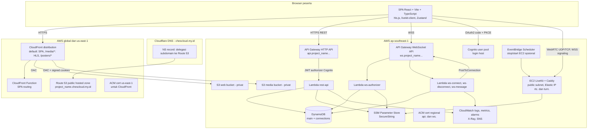
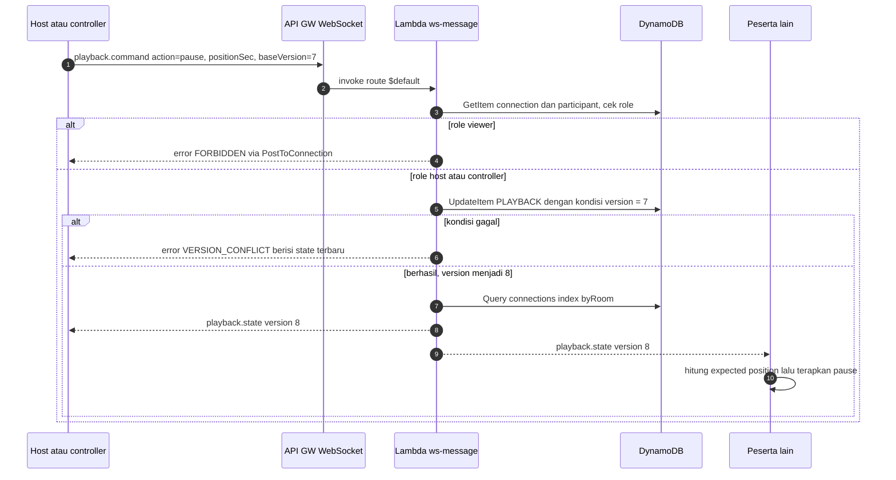
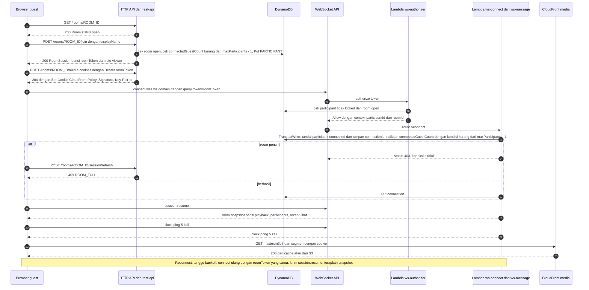
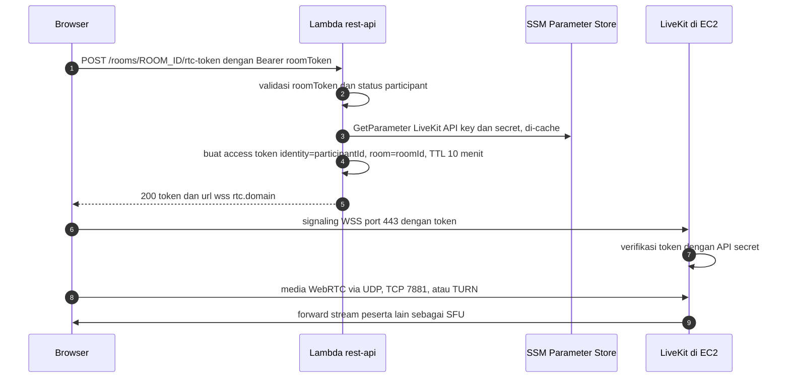
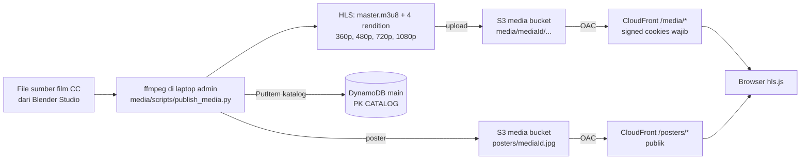

# Arsitektur — Watch Party

> Nama produk masih nama kerja; difiksasi Senin 2 Nov 2026. Semua identifier teknis memakai variabel Terraform `project_name` (placeholder `watchparty`). Domain aplikasi ditulis `<project_name>.chescloud.my.id`, contoh `watchparty.chescloud.my.id`.

| Atribut | Nilai |
|---|---|
| Status | Draft, mengikuti PRD 2.0-rc |
| Pemilik | Product & Tech Lead (TBD), dengan kontribusi semua role |
| Terakhir diperbarui | 31 Oktober 2026 |

Dokumen ini berisi detail **bagaimana** sistem dibangun. Isinya boleh berubah selama implementasi tanpa change request PRD, selama tidak mengubah fitur, acceptance criteria, atau NFR di [PRD](PRD-watch-party.md). Keputusan besar dicatat di [adr/](adr/README.md). Kontrak API ada di [contracts/](contracts/): [openapi.yaml](contracts/openapi.yaml), [ws-messages.md](contracts/ws-messages.md), dan [ws-messages.schema.json](contracts/ws-messages.schema.json).

**Label verifikasi** yang dipakai di dokumen ini:
- **verified (AWS docs)** — dicek di dokumentasi resmi AWS saat riset Oktober 2026.
- **verified (sumber pihak ketiga)** — dicek di sumber non-AWS (misalnya situs harga) Oktober 2026.
- **prior knowledge, unverified** — dari pengetahuan sebelumnya, belum dicek ulang. Wajib dicek sebelum dijadikan dasar keputusan.

---

## Daftar Isi

1. [Prinsip Desain](#1-prinsip-desain)
2. [Diagram Komponen](#2-diagram-komponen)
3. [Angka Kunci (Single Source of Truth)](#3-angka-kunci-single-source-of-truth)
4. [Komponen & Justifikasi](#4-komponen--justifikasi)
5. [Alur Utama](#5-alur-utama)
6. [Model Sinkronisasi](#6-model-sinkronisasi)
7. [Data Model DynamoDB](#7-data-model-dynamodb)
8. [Service Limits](#8-service-limits)
9. [Security Design](#9-security-design)
10. [Observability](#10-observability)
11. [Estimasi Biaya](#11-estimasi-biaya)
12. [Environment & Terraform](#12-environment--terraform)
13. [Struktur Monorepo](#13-struktur-monorepo)
14. [Tech Stack & Versi](#14-tech-stack--versi)
15. [Yang Tidak Dipakai](#15-yang-tidak-dipakai)

---

## 1. Prinsip Desain

1. **Free plan first.** Setiap komponen harus bisa berjalan di akun AWS Free plan dan muat di credits. Komponen dengan biaya tetap besar (NAT Gateway, ElastiCache, ALB) dilarang.
2. **Serverless + satu EC2.** Semua logika aplikasi di Lambda (di luar VPC). Satu-satunya server adalah EC2 untuk LiveKit, karena SFU WebRTC butuh proses yang selalu hidup dan port UDP.
3. **State-based sync.** Server menyimpan state playback sebagai sumber kebenaran. Client menghitung posisi sendiri dari state itu, bukan sekadar meneruskan event.
4. **Contract-first.** OpenAPI dan skema pesan WebSocket di-freeze di awal agar FE dan BE bisa bekerja paralel dengan mock.
5. **Semua lewat Terraform.** ClickOps hanya untuk langkah bootstrap di [runbooks/bootstrap.md](runbooks/bootstrap.md).
6. **Graceful degradation.** Video chat terpisah dari jalur film dan sync. Jika LiveKit mati, film, chat, dan reaction tetap jalan.

## 2. Diagram Komponen



## 3. Angka Kunci (Single Source of Truth)

Semua dokumen lain (PRD, contracts, ADR) harus memakai angka dari tabel ini. Jika angka berubah, ubah di sini dulu, lalu sinkronkan dokumen lain dalam PR yang sama.

### 3.1 Target (dari PRD)

| Item | Nilai |
|---|---|
| Command propagation latency | p95 < 500 ms |
| Drift steady state | p95 < 500 ms |
| Join-to-first-frame | p95 < 3 s |
| Page load (LCP) | < 2 s |
| Peserta per room | 10 (maks; = batas platform, lihat §3.2 "Batas platform peserta") |
| Skala demo | 1 room |
| Ketersediaan API | ≥ 99% non-5xx |
| Resync setelah reconnect | ≤ 5 s setelah jaringan pulih |
| Cache hit ratio `/media/*` | > 90% |
| Latensi AV (target dependency) | < 300 ms |

### 3.2 Parameter Aplikasi

| Item | Nilai |
|---|---|
| Batas platform peserta | 10 peserta terhubung per room (termasuk host). Ini default **dan** nilai maksimum di v1. Nilainya dari variabel Terraform `room_max_participants` (default `10`, validasi 2–10) yang diteruskan ke Lambda `rest-api` sebagai env `ROOM_MAX_PARTICIPANTS`. Kode tidak boleh meng-hardcode angka 10. Alasan angka 10 (batas teknis/biaya, bukan aturan bisnis): SFU LiveKit di satu EC2 kecil meneruskan ≈ n × (n − 1) stream; 10 peserta ≈ 90 stream ≈ 30 Mbps egress (lihat §11.1), dan egress adalah biaya variabel terbesar di budget credits |
| Kapasitas room | Maks `maxParticipants` peserta **terhubung** (termasuk host). `maxParticipants` disimpan di item `META` saat room dibuat dan tidak berubah; default = batas platform. 1 tempat selalu dicadangkan untuk host, jadi guest terhubung maks `maxParticipants − 1` (default 9). Dicek saat join (REST) dan dikunci saat WebSocket `$connect` (lihat §7.4 AP-4, AP-14) |
| Pilihan batas oleh host (F-1.8, Could) | `maxParticipants` 2–10 (min 2 = host + 1 guest; maks = batas platform). Nilai di luar rentang atau di atas `ROOM_MAX_PARTICIPANTS` → `400 VALIDATION_ERROR` |
| Panjang `roomId` | 12 karakter acak base62 |
| Display name | 1–32 karakter (setelah trim, tanpa control character) |
| Teks chat | 1–500 karakter |
| Chat terakhir di snapshot | 20 pesan |
| Emoji reaction | `thumbsUp` 👍, `heart` ❤️, `laugh` 😂, `wow` 😮, `sad` 😢 |
| Masa hidup room | 24 jam sejak dibuat (lalu otomatis `closed`) |
| Retensi data room/chat | 24 jam setelah room berakhir (DynamoDB TTL) |
| TTL room token | 4 jam; client refresh saat sisa < 30 menit |
| TTL signed cookies | 2 jam; client minta ulang setiap 90 menit |
| TTL LiveKit access token | 10 menit (hanya dipakai saat connect) |
| Heartbeat WebSocket | `heartbeat` dikirim jika tidak ada pesan lain selama 5 menit |
| Clock sync | 5 sampel `clock.ping` saat connect/resume (jeda 200 ms), lalu 1 sampel setiap 60 s |
| Reconnect backoff | 1, 2, 4, 8, 16, lalu maks 30 s, dengan jitter ±20% |
| Drift: abaikan | < 250 ms |
| Drift: koreksi rate | 250 ms – 1 s → `playbackRate` 0.95 atau 1.05, kembali ke 1.0 saat drift < 100 ms |
| Drift: hard seek | > 1 s |
| Laporan metric client | `metrics.report` setiap 30 s |
| Ukuran pesan client → server | ≤ 4 KB (aplikasi); batas API Gateway frame 32 KB |
| Ukuran pesan server → client | ≤ 64 KB (aplikasi); batas API Gateway payload 128 KB |

### 3.3 Rate Limit Aplikasi (per peserta)

Rate limit aplikasi memakai **fixed window 10 detik** per koneksi (lihat §9.8). Artinya batas berlaku per window, bukan per 10 detik bergeser. Contoh: `chat.send` 5 per 10 s berarti pesan ke-6 di window yang sama ditolak; di batas dua window, 10 pesan dalam waktu singkat masih bisa diterima. `metrics.report` memakai window 15 s.

| Pesan / aksi | Batas |
|---|---|
| `chat.send` | 5 per 10 s |
| `reaction.send` | 10 per 10 s |
| `playback.command` | 10 per 10 s |
| `player.status` | 10 per 10 s |
| `clock.ping` | 10 per 10 s |
| `metrics.report` | 1 per 15 s |
| REST (throttling stage API Gateway) | rate 20 req/s, burst 40 (untuk seluruh stage, bukan per peserta) |
| WebSocket (throttling stage API Gateway) | rate 100 msg/s, burst 200 (untuk seluruh stage, bukan per peserta) |

### 3.4 Infrastruktur

| Item | Nilai |
|---|---|
| Region utama | `ap-southeast-1` (variabel `aws_region`) |
| Region sertifikat CloudFront | `us-east-1` |
| EC2 LiveKit | variabel `rtc_instance_type`, default `t3.small`, fallback `c7i-flex.large` |
| Budget bulanan | variabel `monthly_budget_usd`, default 50 USD |
| Alert budget | 25%, 50%, 75%, 90% |
| Retensi CloudWatch Logs | 14 hari |
| Environment | `prod` (variabel `env`) |

## 4. Komponen & Justifikasi

| Komponen | Fungsi | Justifikasi | Alternatif ditolak |
|---|---|---|---|
| S3 (web bucket) + CloudFront + OAC | Hosting SPA | Murah, global CDN, bucket tetap privat | S3 website hosting publik (tidak bisa HTTPS custom domain, bucket publik) |
| CloudFront Function | SPA routing (path tanpa ekstensi → `/index.html`) | Custom error response berlaku di seluruh distribution dan akan mengubah 403 `/media/*` menjadi HTML; Function hanya dipasang di default behavior | Lambda@Edge (dilarang, lebih mahal dan lambat deploy) |
| S3 (media bucket) + CloudFront `/media/*` + signed cookies | Delivery HLS | Satu cookie untuk ratusan segmen; cache key tidak berubah per user sehingga cache tetap efisien | Signed URLs (harus menandatangani tiap segmen/playlist), MediaPackage (biaya) |
| API Gateway HTTP API + Lambda `rest-api` | REST: katalog, room, join, token, cookies | Lebih murah dan sederhana dari REST API; JWT authorizer Cognito bawaan | API Gateway REST API (lebih mahal), Express di Lambda (tidak perlu) |
| API Gateway WebSocket API + Lambda | Sync, chat, reaction, presence | Managed, bayar per pesan, tidak ada server yang selalu hidup | Socket.io/Express di EC2 (server tambahan), AppSync (model berbeda) |
| DynamoDB (on-demand) | State room, peserta, chat, katalog, koneksi | Latensi rendah, conditional write untuk optimistic concurrency, TTL bawaan | ElastiCache Redis (biaya tetap, butuh VPC + NAT; Lambda juga tidak bisa subscribe Pub/Sub) |
| Cognito user pool | Login host | Managed, gratis untuk skala kecil, terintegrasi dengan JWT authorizer | Auth buatan sendiri |
| SSM Parameter Store (SecureString) | Secret: signing key room token, private key CloudFront, LiveKit API key/secret | Standard parameter gratis | Secrets Manager (biaya per secret per bulan) |
| EC2 + LiveKit OSS (Docker) + Caddy | SFU video chat, TURN embedded, TLS Let's Encrypt | Biaya tetap yang bisa diprediksi, portable, mendemonstrasikan infra | Amazon Chime SDK (tidak tersedia untuk akun dari alur "Sign up for AWS (new)"; biaya per menit peserta), LiveKit Cloud (bukan infra sendiri) |
| Route 53 hosted zone | DNS subdomain | Alias record ke CloudFront/API Gateway, validasi ACM otomatis via Terraform | Kelola semua record di Cloudflare (tidak bisa di-Terraform dengan provider AWS saja, tidak bisa alias) |
| ACM | Sertifikat TLS CloudFront (`us-east-1`) dan API Gateway custom domain (`ap-southeast-1`) | Gratis, auto-renew | Sertifikat manual |
| CloudWatch + X-Ray + SNS | Logs, metric, alarm, tracing, notifikasi email | Bawaan, ada kuota gratis | Grafana/Prometheus self-hosted (server tambahan) |
| EventBridge Scheduler | Stop/start EC2 LiveKit di luar jam kerja (opsional) | Hemat biaya EC2 tanpa Lambda tambahan | Lambda cron |
| AWS Budgets | Alarm biaya/credits | Proteksi biaya sejak hari 1 | — |

## 5. Alur Utama

### 5.1 Sinkronisasi Playback (perintah dari host/controller)



### 5.2 Join, Late Join, dan Reconnect



Catatan:
- Koneksi WebSocket baru benar-benar terbentuk setelah integrasi `$connect` selesai, dan jika `$connect` gagal (authorizer menolak atau integrasi mengembalikan error), koneksi tidak dibuat (**verified (AWS docs)**, [$connect dan $disconnect](https://docs.aws.amazon.com/apigateway/latest/developerguide/apigateway-websocket-api-route-keys-connect-disconnect.html)). Karena itu server tidak mengirim apa pun selama `$connect`, dan client wajib mengirim `session.resume` setelah koneksi terbuka.
- **Kapasitas room (PRD BR-3):** tempat (seat) baru dipakai saat `$connect`, bukan saat join REST. Join REST hanya pre-check agar orang ke-11 langsung melihat "Room penuh". Batas yang mengikat ada di conditional write `$connect` (AP-14), sehingga join bersamaan, peserta yang belum membuka WebSocket, atau peserta yang reconnect tidak bisa membuat room lebih dari `maxParticipants` peserta terhubung. Peserta yang reconnect setelah tempatnya terisi orang lain juga mendapat `ROOM_FULL`.
- Host yang kembali (tab baru) memanggil `POST /rooms/{roomId}/join` dengan access token Cognito. Server mengenali `sub` Cognito sebagai host room dan mengembalikan `participantId` host yang sama. Host tidak dihitung di `connectedGuestCount`, jadi host selalu bisa masuk.
- **Host putus (PRD BR-7):** `$disconnect` host (AP-13) hanya menandai `PARTICIPANT` host `connected = false`. AP-13 **tidak** mengubah item `PLAYBACK` dan **tidak** mengubah peran siapa pun. Film tetap berjalan karena setiap client menghitung posisi dari state server (§6.2), bukan dari pesan host. Peserta lain menerima `participant.updated` dengan `connected = false` untuk host, jadi host tetap tampil di daftar sebagai offline. Saat host terhubung lagi, peserta lain menerima `participant.updated` dengan `connected = true` (AP-14). Guest yang putus tetap dihapus dari daftar lewat `participant.left`.
- Satu peserta hanya punya satu koneksi aktif. Koneksi baru dengan `participantId` yang sama menggantikan koneksi lama (AP-14): `PARTICIPANT.connectionId` diganti ke koneksi baru dan item `connections` untuk koneksi baru dibuat (agar koneksi baru menerima broadcast), lalu koneksi lama menerima `session.ended` dengan `reason = replaced` dan diputus. `$disconnect` dari koneksi lama tidak mengubah presence (AP-13).

### 5.3 Token Video Chat (LiveKit)



- Token LiveKit dibuat di Lambda dengan LiveKit Python server SDK. Lambda tidak perlu memanggil server LiveKit untuk membuat token.
- Kick (v1.1) memanggil API server LiveKit (RoomService `RemoveParticipant`) lewat HTTPS publik `rtc.` agar peserta juga keluar dari video chat.
- Grant untuk **setiap** peserta (semua peran, apa pun status kamera/mikrofonnya): `roomJoin`, `canPublish`, `canSubscribe`; `canPublishData = false` (data chat lewat WebSocket API, bukan LiveKit). Di LiveKit, izin publish dan subscribe terpisah, jadi peserta yang kamera dan mikrofonnya mati tetap menerima video/audio peserta lain (PRD AC-3.3.3). Menyalakan atau mematikan kamera hanya mengubah track yang di-publish, bukan izin di token (**verified (sumber pihak ketiga)**, [LiveKit access tokens & grants](https://docs.livekit.io/realtime/server/generating-tokens/)).

### 5.4 Pipeline Media



| Rendition | Resolusi | Video bitrate (target) | Audio |
|---|---|---|---|
| 360p | 640×360 | ~800 kbps | AAC 128 kbps (semua rendition) |
| 480p | 854×480 | ~1.400 kbps | |
| 720p | 1280×720 | ~2.800 kbps | |
| 1080p | 1920×1080 | ~5.000 kbps | |

- Codec H.264 + AAC, segmen HLS 4 detik, keyframe setiap 2 detik (seek lebih presisi). Kontainer segmen: fMP4 (didukung hls.js dan Safari).
- `Cache-Control: public, max-age=31536000, immutable` untuk playlist dan segmen (konten VOD tidak berubah). Jika film diganti, pakai `mediaId` baru.
- Script dijalankan oleh RTC/Media dengan kredensial IAM user + MFA. Detail opsi ffmpeg ada di README script (dibuat saat implementasi).
- Film awal: *Big Buck Bunny*, *Sintel*, *Tears of Steel* (Blender Foundation, Creative Commons Attribution). Atribusi ditampilkan di katalog.

## 6. Model Sinkronisasi

### 6.1 State Playback

Server menyimpan satu item state per room (lihat [§7](#7-data-model-dynamodb)). Nama field sama dengan kontrak ([ws-messages.md](contracts/ws-messages.md)).

| Field | Tipe | Arti |
|---|---|---|
| `roomId` | string | ID room |
| `mediaId` | string | Film yang diputar |
| `status` | `playing` \| `paused` | Status playback |
| `positionSec` | number | Posisi (detik) saat `updatedAtServerMs` |
| `playbackRate` | number | Kecepatan room (v1 selalu 1.0) |
| `updatedAtServerMs` | integer | Waktu server (epoch ms) saat state terakhir berubah |
| `version` | integer | Naik 1 setiap perubahan; dipakai untuk optimistic concurrency |

### 6.2 Posisi yang Diharapkan

```text
serverNowMs        = clientNowMs + clockOffsetMs
expectedPositionSec = positionSec                                    jika status = paused
expectedPositionSec = positionSec + (serverNowMs - updatedAtServerMs) / 1000 * playbackRate   jika status = playing
```

Jika `expectedPositionSec` ≥ durasi film, client menampilkan akhir film dan berhenti di frame terakhir.

### 6.3 Estimasi Clock Offset (gaya NTP)

1. Client mengirim `clock.ping` dengan `clientSendMs`.
2. Server membalas `clock.pong` dengan `clientSendMs` dan `serverTimeMs`.
3. Client mencatat `clientRecvMs`. `rttMs = clientRecvMs − clientSendMs`. `offsetMs = serverTimeMs − (clientSendMs + rttMs / 2)`.
4. Dari 5 sampel saat connect/resume, pakai sampel dengan `rttMs` terkecil. Setelah itu 1 sampel setiap 60 s; offset diperbarui jika RTT sampel baru ≤ 1,5 × RTT terbaik.

### 6.4 Koreksi Drift

`driftMs = (actualPositionSec − expectedPositionSec) × 1000`

| Kondisi | Aksi client | Status UI |
|---|---|---|
| \|drift\| < 250 ms | Tidak ada | Ready |
| 250 ms ≤ \|drift\| ≤ 1 s | `playbackRate` 1.05 jika tertinggal, 0.95 jika kelebihan; kembali ke 1.0 saat \|drift\| < 100 ms | Syncing |
| \|drift\| > 1 s | Hard seek ke `expectedPositionSec` | Syncing |
| Player menunggu data | Tidak ada koreksi sampai data siap, lalu hard seek bila perlu | Buffering |

Pengecekan drift dilakukan setiap 1 detik. Buffering satu peserta tidak mem-pause room (PRD BR-5).

### 6.5 Concurrency

- Setiap `playback.command` membawa `baseVersion` (versi state yang dilihat client).
- Lambda melakukan `UpdateItem` dengan `ConditionExpression: version = :baseVersion`, lalu menaikkan `version`.
- Jika kondisi gagal, server membalas `error` dengan `code = VERSION_CONFLICT` dan `details.currentState`. Client menerapkan state terbaru; pengguna bisa mengulang aksi.
- Client mengabaikan `playback.state` dengan `version` ≤ versi yang sudah diterapkan (pesan datang tidak berurutan).

### 6.6 Arti `positionSec` per Aksi

| Aksi | `positionSec` yang dikirim | State baru |
|---|---|---|
| `play` | Posisi lokal pengirim saat menekan play | `status = playing` |
| `pause` | Posisi lokal pengirim saat menekan pause | `status = paused` |
| `seek` | Posisi tujuan | `status` tidak berubah |

## 7. Data Model DynamoDB

### 7.1 Keputusan: Dua Tabel

| Tabel | Isi | Alasan |
|---|---|---|
| `<project_name>-<env>-main` | Katalog, room, state playback, peserta, chat (single-table) | Semua data satu room bisa dibaca dengan 1–2 Query pada partition `ROOM#<roomId>`; tidak perlu join |
| `<project_name>-<env>-connections` | Koneksi WebSocket aktif + GSI `byRoom` | Churn tinggi (connect/disconnect), TTL berbeda, dan hanya tabel ini yang butuh GSI. Memisahkannya membuat GSI kecil dan tabel `main` tetap sederhana |

Satu tabel untuk semuanya juga bisa, tetapi GSI `byRoom` akan ikut mengindeks item non-koneksi (atau butuh sparse index yang lebih sulit dipahami tim baru). Dua tabel adalah kompromi yang paling mudah dipahami. Keduanya on-demand capacity, enkripsi default, TTL pada atribut `expiresAt` (epoch **detik**).

> **Pengecualian penamaan:** aturan sufiks `Ms`/`Sec` berlaku untuk field JSON di kontrak. `expiresAt` adalah atribut internal DynamoDB yang tidak pernah dikirim ke client, dan DynamoDB TTL wajib memakai epoch detik. Nama ini sengaja tidak memakai sufiks `Sec` agar tidak tertukar dengan arti `Sec` = posisi/durasi. Field kontrak yang setara adalah `Room.expiresAtMs` (epoch ms, akhir masa hidup room).

### 7.2 Tabel `main`

| Entity | PK | SK | Atribut utama |
|---|---|---|---|
| Media (katalog) | `CATALOG` | `MEDIA#<mediaId>` | `title`, `description`, `durationSec`, `posterPath`, `playbackPath`, `license`, `attribution`, `sortOrder` |
| Room | `ROOM#<roomId>` | `META` | `mediaId`, `status` (`open`/`closed`), `hostUserId` (Cognito `sub`), `hostParticipantId`, `hostDisplayName`, `maxParticipants` (batas peserta terhubung termasuk host, 2–10, tidak berubah setelah room dibuat), `connectedGuestCount` (guest yang sedang terhubung, 0 sampai `maxParticipants − 1`), `createdAtMs`, `closedAtMs`, `expiresAt` |
| Playback state | `ROOM#<roomId>` | `PLAYBACK` | `status`, `positionSec`, `playbackRate`, `updatedAtServerMs`, `version`, `mediaId`, `expiresAt` |
| Participant | `ROOM#<roomId>` | `PARTICIPANT#<participantId>` | `displayName`, `role`, `playerStatus`, `connected`, `connectionId` (koneksi aktif; kosong jika tidak terhubung), `kicked`, `joinedAtMs`, `expiresAt` |
| Chat message | `ROOM#<roomId>` | `CHAT#<createdAtMs>#<messageId>` | `participantId`, `displayName`, `text`, `createdAtMs`, `expiresAt` |

Nilai `expiresAt` (epoch detik) untuk item room:
- Saat dibuat: `createdAtMs / 1000` + 48 jam (masa hidup 24 jam + retensi 24 jam).
- Saat host menutup room (v1.1): `closedAtMs / 1000` + 24 jam.
- Item katalog tidak punya `expiresAt`.

Akhir masa hidup room (`Room.expiresAtMs` di kontrak) = `createdAtMs` + 24 jam. Nilai ini tidak disimpan terpisah, tetapi dihitung dari `createdAtMs`.

> DynamoDB TTL menghapus item secara asinkron (bisa tertunda sampai sekitar 48 jam, **prior knowledge, unverified**). Karena itu kode wajib menganggap item dengan `expiresAt` lewat sebagai tidak ada, dan room yang `createdAtMs` + 24 jam sudah lewat sebagai `closed`. Dengan aturan ini, data tidak bisa diakses lewat aplikasi setelah `expiresAt`, walaupun item fisiknya baru terhapus belakangan (PRD NFR-3.7).

### 7.3 Tabel `connections`

| PK | Atribut | GSI `byRoom` |
|---|---|---|
| `connectionId` | `roomId`, `participantId`, `isHost`, `connectedAtMs`, `roomExpiresAtMs` (disalin dari room saat `$connect`, untuk cek expiry tanpa baca `META`), `expiresAt` (epoch detik, = connect + 3 jam), counter rate limit | PK `roomId`, SK `connectionId`, projection INCLUDE `participantId` |

### 7.4 Access Patterns

| # | Access pattern | Operasi |
|---|---|---|
| AP-1 | Daftar katalog | Query `main` PK = `CATALOG` |
| AP-2 | Buat room | TransactWriteItems: Put `META` (dengan `maxParticipants` dari request, atau batas platform `ROOM_MAX_PARTICIPANTS` jika tidak dikirim; `connectedGuestCount = 0`) + `PLAYBACK` + `PARTICIPANT` host (kondisi item belum ada) |
| AP-3 | Ringkasan room (halaman join) | GetItem `META` + Query `PARTICIPANT#` (hitung `connected = true` untuk `participantCount`) |
| AP-4 | Join guest (pre-check kapasitas) | AP-3. Jika `connectedGuestCount` ≥ `maxParticipants − 1` → `409 ROOM_FULL`. Jika tidak, Put `PARTICIPANT` dengan `connected = false`. Join belum memakai tempat; tempat dikunci di AP-14 |
| AP-5 | Host kembali | GetItem `META`, bandingkan `hostUserId` dengan `sub` Cognito, pakai `hostParticipantId` |
| AP-6 | Snapshot | Query PK = `ROOM#id`, SK ≥ `META` (META, PARTICIPANT, PLAYBACK) + Query SK begins_with `CHAT#`, descending, limit 20 |
| AP-7 | Perintah playback | UpdateItem connection (counter rate limit, `ReturnValues = ALL_NEW`, juga memberi `roomExpiresAtMs` untuk AP-15) → GetItem `PARTICIPANT` (role) → UpdateItem `PLAYBACK` dengan kondisi `version` |
| AP-8 | Fan-out | Query `connections` GSI `byRoom` PK = `roomId` → PostToConnection paralel. Jika 410 Gone: jalankan AP-13 untuk koneksi itu (karena `$disconnect` bersifat best-effort) |
| AP-9 | Chat | Put `CHAT#...` → AP-8 |
| AP-10 | Grant/revoke controller | UpdateItem `PARTICIPANT.role` dengan kondisi `role <> host` → AP-8 |
| AP-11 | Kick (v1.1) | GetItem `PARTICIPANT` → TransactWriteItems: Update `PARTICIPANT` `kicked = true`, `connected = false`, hapus `connectionId` (kondisi `connectionId` sama dengan yang dibaca) + jika tadi `connected = true`, Update `META` `connectedGuestCount − 1`. Jika transaksi berhasil: kirim `participant.left` (`reason = kicked`) ke peserta lain (AP-8, tanpa koneksi X) → kirim `session.ended` (`kicked`) ke X → DeleteConnection X. `$disconnect` X setelah itu hanya menghapus item connection; kondisi AP-13 gagal, jadi `participant.left` tidak terkirim dua kali |
| AP-12 | Tutup room (v1.1) | UpdateItem `META` → update `expiresAt` semua item room → kirim `session.ended` → DeleteConnection semua |
| AP-13 | Disconnect (`$disconnect` atau 410 Gone di AP-8) | DeleteItem connection → TransactWriteItems: Update `PARTICIPANT` `connected = false`, hapus `connectionId` dengan `ConditionExpression: connectionId = :thisConnectionId AND connected = true` + (guest saja) Update `META` `connectedGuestCount − 1`. **Hanya jika** transaksi berhasil, kirim ke peserta lain (AP-8): `participant.left` (`disconnected`) untuk guest, atau `participant.updated` dengan `connected = false` untuk host (host tetap di daftar sebagai offline, PRD BR-7). Jika kondisi gagal (koneksi sudah diganti, sudah di-kick, atau sudah diproses), tidak ada perubahan presence. AP-13 tidak pernah mengubah item `PLAYBACK` dan tidak mengubah `role` peserta mana pun (BR-7) |
| AP-14 | Connect (`$connect`, Lambda `ws-connect`) | GetItem `PARTICIPANT` + GetItem `META` (untuk `maxParticipants` dan `roomExpiresAtMs`). **Kasus ganti koneksi** (`connected = true`): Update `PARTICIPANT` `connectionId = :new` dengan kondisi `connectionId = :old AND connected = true AND kicked = false`, tanpa mengubah counter → Put connection baru (dengan `roomId`, `participantId`, `isHost`, `roomExpiresAtMs`) → kirim `session.ended` (`replaced`) ke koneksi lama → DeleteConnection lama (410 Gone diabaikan; item connection lama dihapus oleh AP-13). Tidak ada `participant.joined`, karena peserta sudah tampil. Jika kondisi gagal (misalnya AP-13 koneksi lama diproses lebih dulu): baca ulang `PARTICIPANT` satu kali dan jalankan kasus yang sesuai (biasanya kasus baru terhubung, dengan cek kapasitas). Jika gagal lagi → kembalikan 403, koneksi ditolak. **Kasus baru terhubung** (`connected = false`): TransactWriteItems: Update `PARTICIPANT` `connected = true`, `connectionId = :new` (kondisi `connected = false AND kicked = false`) + (guest saja) Update `META` `connectedGuestCount + 1` (kondisi `connectedGuestCount < :guestSeats`, dengan `:guestSeats = maxParticipants − 1` dihitung di kode dari `META`). Jika kondisi kapasitas gagal → kembalikan 403, koneksi ditolak. Jika berhasil → Put connection (dengan `roomExpiresAtMs`) → kirim ke peserta lain (AP-8): `participant.joined` untuk guest, atau `participant.updated` dengan `connected = true` untuk host |
| AP-15 | Expiry room saat terhubung | Setiap pesan masuk ke `ws-message`: jika waktu server ≥ `roomExpiresAtMs` (dibaca bersama counter rate limit, seperti AP-7), kirim `session.ended` (`expired`) ke pengirim lalu DeleteConnection. Client juga memasang timer dari `room.expiresAtMs` sehingga peserta yang diam tetap melihat "Room telah berakhir" tepat waktu (ws-messages §4.5) |

Urutan SK secara leksikografis: `CHAT#...` < `META` < `PARTICIPANT#...` < `PLAYBACK`, sehingga AP-6 bisa memakai kondisi `SK >= "META"`.

Condition expression DynamoDB hanya mendukung perbandingan antar operand (nama atribut atau nilai), tanpa operasi aritmatika (**verified (AWS docs)**, [Condition and filter expressions](https://docs.aws.amazon.com/amazondynamodb/latest/developerguide/Expressions.OperatorsAndFunctions.html)). Karena itu `maxParticipants − 1` dihitung di kode lalu dikirim sebagai nilai `:guestSeats` (AP-14). Cara ini aman karena `maxParticipants` tidak pernah berubah setelah room dibuat.

## 8. Service Limits

| Service | Limit | Nilai | Dampak ke desain | Verifikasi |
|---|---|---|---|---|
| API Gateway WebSocket | Durasi koneksi maks | 2 jam | Reconnect + resync otomatis (F-2.5) | verified (AWS docs) |
| API Gateway WebSocket | Idle timeout | 10 menit | Heartbeat 5 menit | verified (AWS docs) |
| API Gateway WebSocket | Ukuran frame | 32 KB | Pesan client ≤ 4 KB | verified (AWS docs) |
| API Gateway WebSocket | Payload pesan | 128 KB | Pesan server ≤ 64 KB, chat di snapshot dibatasi 20 | verified (AWS docs) |
| API Gateway WebSocket | Integration timeout | 29 s | Handler harus cepat; tidak ada proses panjang di jalur WS | verified (AWS docs) |
| API Gateway WebSocket | Koneksi baru per detik per akun | 500 | Jauh di atas kebutuhan 1 room | verified (AWS docs) |
| API Gateway WebSocket | `$connect` gagal → koneksi tidak dibuat; koneksi baru aktif setelah `$connect` selesai | — | Cek kapasitas di `$connect` (AP-14); snapshot dikirim lewat `session.resume` | verified (AWS docs) |
| API Gateway WebSocket | `$disconnect` bersifat best-effort (tidak dijamin terkirim) | — | Presence juga dibersihkan saat PostToConnection 410 Gone (AP-8 → AP-13) | verified (AWS docs) |
| API Gateway HTTP API | Integration timeout maks | 30 s | Semua endpoint REST < 1 s | prior knowledge, unverified |
| Lambda | Concurrent executions per region | 1.000 default, akun baru bisa jauh lebih kecil (misalnya 10) | Cek di hari 1 lewat Service Quotas; ajukan kenaikan jika kecil | prior knowledge, unverified |
| DynamoDB | Ukuran item | 400 KB | Item kecil, tidak masalah | prior knowledge, unverified |
| Cognito | Email bawaan (tanpa SES) | ±50 email/hari | Cukup untuk verifikasi akun host di demo | prior knowledge, unverified |
| EC2 Free plan | Instance type eligible | t3.micro, t3.small, t4g.micro, t4g.small, c7i-flex.large, m7i-flex.large | `rtc_instance_type` hanya boleh dari daftar ini | verified (AWS docs) |
| CloudFront | Free tier selalu gratis | 1 TB transfer + 10 juta request per bulan | Delivery film masuk kuota gratis | prior knowledge, unverified |
| ACM untuk CloudFront | Region | Wajib `us-east-1` | Provider alias `us_east_1` di Terraform | verified (AWS docs) |

Sumber baris "verified (AWS docs)": [API Gateway quotas](https://docs.aws.amazon.com/apigateway/latest/developerguide/limits.html) (batas WebSocket), [$connect dan $disconnect](https://docs.aws.amazon.com/apigateway/latest/developerguide/apigateway-websocket-api-route-keys-connect-disconnect.html), [EC2 Free Tier](https://docs.aws.amazon.com/AWSEC2/latest/UserGuide/ec2-free-tier-usage.html) (instance type), [CloudFront SSL/TLS requirements](https://docs.aws.amazon.com/AmazonCloudFront/latest/DeveloperGuide/cnames-and-https-requirements.html) (ACM `us-east-1`). Baris "prior knowledge, unverified" wajib dicek di hari 1 jika menjadi dasar keputusan (contoh: kuota Lambda di [runbooks/bootstrap.md](runbooks/bootstrap.md) cek D7).

## 9. Security Design

### 9.1 Identitas & Akses Manusia

- **Root user:** MFA, tanpa access key, tidak dipakai harian.
- **IAM users (satu per anggota)** dengan MFA wajib. Policy "deny semua kecuali kelola MFA sendiri jika `aws:MultiFactorAuthPresent` false".
  - Grup `admins` (Platform, Lead): akses admin.
  - Grup `developers` (role lain): read-only + akses spesifik (misalnya upload ke media bucket untuk RTC/Media, Session Manager ke EC2 LiveKit, baca logs).
- Access key CLI hanya untuk yang butuh, dan dipakai lewat sesi MFA (`aws sts get-session-token`).
- **Tidak ada IAM Identity Center** karena butuh AWS Organizations (dilarang, lihat [ADR-0001](adr/0001-aws-account-free-plan.md)).

### 9.2 Akses CI (GitHub Actions OIDC)

| IAM role | Dipakai untuk | Trust (`sub` claim) | Permission |
|---|---|---|---|
| `<project_name>-gha-plan` | `terraform plan` di PR, lint | `repo:<org>/<repo>:pull_request` | Read-only + baca/tulis state dan lockfile di state bucket |
| `<project_name>-gha-deploy` | `terraform apply`, upload SPA, invalidasi CloudFront | `repo:<org>/<repo>:environment:prod` | Hak deploy untuk resource berprefix `<project_name>-*`; IAM dibatasi ke `role/<project_name>-*` |

- Environment GitHub `prod` memakai required reviewer agar apply butuh persetujuan manual.
- Tidak ada access key AWS di GitHub Secrets.
- Hak deploy yang masih cukup luas adalah **kompromi praktis** untuk 7 hari kerja, bukan best practice penuh. Dicatat di ADR-0008.

### 9.3 Least Privilege Lambda

Setiap Lambda punya role sendiri. Contoh:

| Lambda | Permission |
|---|---|
| `rest-api` | DynamoDB GetItem/PutItem/UpdateItem/Query/ConditionCheckItem pada tabel `main`; Query pada `connections` + index `byRoom`; DeleteItem pada `connections` (pembersihan koneksi mati saat 410 Gone, AP-13); `execute-api:ManageConnections` pada WebSocket API stage `prod` (untuk broadcast grant/kick/close); `ssm:GetParameter` pada 4 parameter secret |
| `ws-authorizer` | DynamoDB GetItem pada `main`; `ssm:GetParameter` pada signing key room token |
| `ws-connect`, `ws-disconnect` | DynamoDB Put/Delete/Update/Get pada `connections` dan `main`; `dynamodb:Query` pada `connections/index/byRoom` (fan-out `participant.joined`/`participant.left` lewat AP-8); `execute-api:ManageConnections` |
| `ws-message` | DynamoDB Get/Put/Update/Query pada `main` dan `connections` (+ index); DeleteItem pada `connections` (pembersihan koneksi mati saat 410 Gone, AP-13); `execute-api:ManageConnections`; `cloudwatch:PutMetricData` tidak perlu (pakai Embedded Metric Format lewat logs) |

`ws-connect`, `ws-disconnect`, `ws-message`, dan `rest-api` (jalur 410 Gone di AP-8 saat fan-out, termasuk AP-10/AP-11/AP-12) memakai `TransactWriteItems` untuk presence dan counter kapasitas (AP-13, AP-14). Izin IAM untuk transaksi dicek per aksi item (`dynamodb:UpdateItem`, `dynamodb:PutItem`, `dynamodb:ConditionCheckItem`) pada tabel terkait (**prior knowledge, unverified**; cek saat menulis policy).

Semua Lambda: `logs:CreateLogStream`/`PutLogEvents` pada log group-nya, `xray:PutTraceSegments`/`PutTelemetryRecords`. Secret SecureString memakai AWS managed key `aws/ssm`, sehingga tidak perlu KMS key sendiri (**prior knowledge, unverified**).

### 9.4 Secret

| Parameter SSM (SecureString) | Isi | Dibuat oleh |
|---|---|---|
| `/<project_name>/<env>/room-token-signing-key` | Key HS256 untuk room token | Runbook (manual, sekali) |
| `/<project_name>/<env>/cloudfront-signing-private-key` | Private key RSA untuk signed cookies | Runbook |
| `/<project_name>/<env>/livekit-api-key` | API key LiveKit | Runbook |
| `/<project_name>/<env>/livekit-api-secret` | API secret LiveKit | Runbook |

Secret dibuat lewat CLI di runbook agar **nilainya tidak pernah masuk Terraform state maupun repo**. Terraform hanya mereferensikan nama parameter. Public key CloudFront boleh di-commit (bukan secret).

### 9.5 S3, CloudFront, Signed Cookies

- Kedua bucket: Block Public Access aktif, enkripsi SSE-S3, bucket policy hanya mengizinkan service principal CloudFront dengan kondisi `AWS:SourceArn` = distribution ini (OAC).
- Behavior CloudFront:

| Path | Origin | Akses | Catatan |
|---|---|---|---|
| default `/*` | web bucket | Publik | CloudFront Function untuk SPA routing; response headers policy (HSTS, CSP, X-Content-Type-Options) |
| `/media/*` | media bucket | Trusted key group (signed cookies) | Cache key tanpa cookie, query string, atau header tambahan |
| `/posters/*` | media bucket | Publik | Poster katalog |

- Signed cookies memakai **custom policy** dengan `Resource = https://<project_name>.chescloud.my.id/media/<mediaId>/*` dan `DateLessThan = sekarang + 2 jam`, sehingga peserta hanya bisa mengakses film room-nya.
- Atribut cookie: `Domain=<project_name>.chescloud.my.id; Path=/media/; Secure; HttpOnly; SameSite=Lax`. Cookie diset oleh `api.` untuk domain parent, sehingga request SPA wajib memakai `credentials: "include"` saat memanggil `POST /rooms/{roomId}/media-cookies`.

### 9.6 CORS

HTTP API CORS:
- `allowOrigins`: hanya `https://<project_name>.chescloud.my.id`
- `allowCredentials`: `true` (dibutuhkan untuk Set-Cookie dari `media-cookies`)
- `allowMethods`: `GET, POST, PUT, DELETE`
- `allowHeaders`: `Authorization, Content-Type`
- `maxAge`: 600

WebSocket tidak memakai CORS; `ws-authorizer` mengecek header `Origin` sama dengan origin aplikasi (defense in depth).

### 9.7 Autentikasi & Otorisasi

Ringkas dari [ADR-0007](adr/0007-authentication-model.md):
- **Cognito** hanya membuktikan identitas host. Login lewat Cognito managed login (OAuth 2.0 authorization code + PKCE), app client publik tanpa secret, domain prefix Cognito (tanpa custom domain).
- **Room token** adalah satu-satunya kredensial di dalam room, untuk semua peserta (host dan guest). Ditandatangani HS256 oleh backend, TTL 4 jam, claim: `iss`, `aud = room`, `sub` = `participantId`, `roomId`, `iat`, `exp`, `jti`.
- **Peran tidak disimpan di token.** Peran (`host`/`controller`/`viewer`) dibaca dari DynamoDB setiap kali ada aksi terlindungi, agar grant/revoke/kick berlaku langsung.
- `POST /rooms` dilindungi JWT authorizer Cognito di HTTP API. `POST /rooms/{roomId}/join` menerima Cognito access token secara opsional (divalidasi di kode dengan JWKS Cognito). Endpoint lain di dalam room memakai room token (divalidasi di kode).
- WebSocket: room token dikirim di query string `$connect` (browser tidak bisa set header WebSocket) dan divalidasi Lambda REQUEST authorizer. Access log API Gateway **tidak boleh** mencatat query string.

### 9.8 Rate Limiting & Validasi

- Throttling stage API Gateway (lihat [§3.3](#33-rate-limit-aplikasi-per-peserta)) + rate limit per peserta di aplikasi (counter **fixed window** 10 s pada item koneksi, window dihitung dari `floor(serverNowMs / 10000)`). Fixed window dipilih karena cukup satu UpdateItem per pesan. Konsekuensinya, di batas dua window jumlah pesan bisa sampai 2× batas dalam waktu singkat; ini diterima. Acceptance criteria di PRD (AC-4.1.4, AC-4.2.2) ditulis per window.
- Semua input divalidasi dengan pydantic (`extra = "forbid"`), batas panjang sesuai §3.2.
- Teks chat dan display name dirender sebagai teks (React escaping, tanpa `dangerouslySetInnerHTML`). CSP mencegah script inline.
- Tidak ada WAF di CloudFront (biaya); proteksi bergantung pada throttling dan rate limit di atas.

### 9.9 EC2 LiveKit

- Tidak ada SSH (port 22 tertutup). Akses shell lewat SSM Session Manager.
- IMDSv2 wajib, EBS terenkripsi, instance profile hanya boleh membaca parameter LiveKit di SSM.
- `credit_specification` T3 = `standard` agar tidak ada biaya surplus CPU credit.
- Security group inbound:

| Port | Protokol | Fungsi |
|---|---|---|
| 80 | TCP | ACME HTTP-01 (Let's Encrypt) + redirect ke HTTPS |
| 443 | TCP | Caddy: signaling WSS `rtc.` dan TURN/TLS `turn.` (routing berdasarkan SNI) |
| 7881 | TCP | ICE/TCP fallback |
| 3478 | UDP | TURN/UDP (juga STUN) |
| 50000–60000 | UDP | ICE/UDP media |

Port mengikuti [dokumentasi LiveKit](https://docs.livekit.io/home/self-hosting/ports-firewall/). TURN/TLS harus di port 443 jika tidak memakai load balancer, sehingga dibutuhkan hostname terpisah `turn.` dan routing SNI di Caddy (pola deployment VM LiveKit). Sertifikat TLS dari Let's Encrypt (self-signed tidak diterima browser/WebRTC).

### 9.10 Privasi

- Tidak ada recording audio/video. LiveKit tidak menyimpan media.
- Data room, peserta, dan chat dihapus otomatis lewat TTL (lihat §7). Guest hanya menyimpan display name.
- Log aplikasi tidak boleh berisi isi chat, token, atau cookie.

## 10. Observability

### 10.1 SLI & SLO

Tabel ini adalah definisi teknis untuk SLI di PRD §14 dan metode NFR-1.1–1.3. PRD hanya menyebut apa yang diukur; rumus dan nama pesan ada di sini dan di [ws-messages.md](contracts/ws-messages.md).

**SLI runtime (punya metric CloudWatch dan tampil di dashboard):**

| SLI | Definisi | SLO | Sumber | Alarm (§10.2) |
|---|---|---|---|---|
| `CommandLatencyMs` | `appliedAtClientMs + clockOffsetMs − updatedAtServerMs` per perintah playback | p95 < 500 ms | `metrics.report` → EMF | #7 |
| `DriftMs` | `abs(actualPositionSec − expectedPositionSec) × 1000`, sampel tiap 1 s | p95 < 500 ms | `metrics.report` → EMF | #6 |
| `JoinToFirstFrameMs` | Klik Join → event `loadeddata` di elemen video | p95 < 3.000 ms | `metrics.report` → EMF | Tidak ada (dicek di dashboard dan hasil test, lihat catatan) |
| `RttMs` | RTT `clock.ping` | Informasi | `metrics.report` → EMF | Tidak ada |
| Ketersediaan API | 1 − (5xx / total) untuk HTTP API dan WebSocket | ≥ 99% | Metric API Gateway | #1, #5 |

**SLI non-runtime (tidak punya metric CloudWatch; diukur dengan metode di PRD §8):**

| SLI | SLO | Cara ukur |
|---|---|---|
| Page load (LCP) | < 2 s | Lighthouse (NFR-1.4) |
| Resync setelah reconnect | ≥ 99% berhasil ≤ 5 s | E2E test (NFR-2.2) |
| Cache hit ratio `/media/*` | > 90% | CloudFront Cache Statistics di console (NFR-1.8) |
| Biaya | 0 tagihan; credits ≤ budget | AWS Budgets + halaman Credits (NFR-5.2) |

Catatan: `JoinToFirstFrameMs` tidak diberi alarm karena jumlah sampelnya kecil (1 per join) dan kuota alarm dibatasi 10. SLI ini dicek di dashboard dan di hasil test 20 percobaan (NFR-1.3).

Metric client ditulis oleh `ws-message` dengan Embedded Metric Format (Powertools Metrics) ke namespace `<project_name>/client`, dimensi hanya `Env` (hindari dimensi `roomId` agar jumlah metric tetap kecil).

### 10.2 Alarm

Jumlah alarm dibatasi maksimal 10 agar tetap di kuota gratis CloudWatch (**prior knowledge, unverified**).

| # | Alarm | Kondisi |
|---|---|---|
| 1 | REST 5xx rate | > 1% selama 5 menit |
| 2 | Lambda errors (semua fungsi, metric math) | > 0 pada 3 dari 5 menit |
| 3 | Lambda throttles (semua fungsi) | > 0 |
| 4 | DynamoDB throttled requests / system errors | > 0 |
| 5 | WebSocket integration error | > 1% selama 5 menit |
| 6 | `DriftMs` p95 | > 500 pada 3 dari 5 menit |
| 7 | `CommandLatencyMs` p95 | > 500 pada 3 dari 5 menit |
| 8 | EC2 `StatusCheckFailed` | ≥ 1 |
| 9 | EC2 `CPUUtilization` | > 80% selama 10 menit |
| 10 | EC2 `CPUCreditBalance` (jika T3) | < 20 |

Notifikasi via SNS topic `<project_name>-<env>-alerts` ke email anggota. Budget alert dikirim AWS Budgets langsung (bukan CloudWatch alarm).

### 10.3 Logs, Tracing, Dashboard

- Log JSON terstruktur (Powertools Logger) dengan `requestId`, `connectionId`, `roomId`. Retensi 14 hari.
- X-Ray active tracing di semua Lambda. HTTP API dan WebSocket API tidak mendukung X-Ray, jadi trace dimulai di Lambda (**prior knowledge, unverified**).
- Satu CloudWatch dashboard: SLI di atas, invocations/errors/duration Lambda, koneksi WebSocket, CPU/network EC2.
- EC2 hanya memakai metric dasar (tanpa CloudWatch agent) untuk menghemat custom metric.

## 11. Estimasi Biaya

> **Semua angka adalah estimasi**, untuk 1 bulan (November 2026), dalam USD, region `ap-southeast-1`. Di Free plan tidak ada tagihan; angka ini adalah **credits yang terpakai**. Credits awal $100 (+ sampai $100 dari aktivitas).

### 11.1 Asumsi Pemakaian

- Pengembangan + test + demo: ±20 jam sesi dengan rata-rata 6 peserta dan ±10 jam sesi dengan 10 peserta.
- Video chat grid memakai simulcast/adaptive stream: ±300 kbps video + 32 kbps audio per stream yang diterima.
  - 10 peserta: tiap peserta menerima 9 stream ≈ 3 Mbps → total ≈ 30 Mbps ≈ 13,5 GB/jam egress.
  - 6 peserta: ≈ 10 Mbps total ≈ 4,5 GB/jam.
  - Total egress LiveKit ≈ 10 × 13,5 + 20 × 4,5 ≈ **225 GB**.
- Film rata-rata ~2 GB per penonton per jam (1080p). ±220 penonton-jam ≈ 440 GB lewat CloudFront.

### 11.2 Tabel Estimasi

| Item | Dasar harga | Skenario A: t3.small, stop terjadwal 16 jam/hari | Skenario B: c7i-flex.large, 24/7 | Verifikasi |
|---|---|---|---|---|
| EC2 LiveKit | t3.small $0,0264/jam; c7i-flex.large ≈ $0,098/jam | 480 jam ≈ $12,7 | 730 jam ≈ $71,5 | t3.small: verified (sumber pihak ketiga); c7i-flex.large: prior knowledge, unverified (diturunkan dari c7i.large Singapore $0,1029/jam) |
| Public IPv4 (Elastic IP) | $0,005/jam, tetap ditagih saat instance stop | $3,7 | $3,7 | verified (AWS docs), [AWS Knowledge Center: public IPv4](https://repost.aws/knowledge-center/vpc-optimize-ipv4-usage) |
| EBS gp3 20 GB | ≈ $0,096/GB-bulan | $1,9 | $1,9 | prior knowledge, unverified |
| Data transfer out EC2 | ≈ $0,12/GB setelah 100 GB gratis per bulan | (225 − 100) × 0,12 ≈ $15 | ≈ $15 | prior knowledge, unverified |
| CloudFront | 1 TB + 10 juta request gratis per bulan | $0 | $0 | prior knowledge, unverified |
| S3 storage (±5 GB) | ≈ $0,025/GB-bulan | $0,2 | $0,2 | prior knowledge, unverified |
| API Gateway WebSocket | $1,00/juta pesan + $0,25/juta menit koneksi (us-east-1; Singapore sedikit lebih mahal) | < $0,5 | < $0,5 | us-east-1: verified (sumber pihak ketiga); Singapore: prior knowledge, unverified |
| API Gateway HTTP API | Ribuan request | ≈ $0 | ≈ $0 | prior knowledge, unverified |
| Lambda | 1 juta request + 400.000 GB-s gratis | $0 | $0 | prior knowledge, unverified |
| DynamoDB on-demand | < 1 juta write | < $1,5 | < $1,5 | prior knowledge, unverified |
| Route 53 hosted zone | $0,50/zone/bulan | $0,5 | $0,5 | prior knowledge, unverified |
| ACM public cert | Gratis | $0 | $0 | prior knowledge, unverified |
| Cognito | ≤ 10.000 MAU gratis (Lite/Essentials) | $0 | $0 | prior knowledge, unverified |
| CloudWatch (logs < 5 GB, 10 alarm, 1 dashboard, ±4 metric EMF) | Sebagian besar masuk kuota gratis | < $1 | < $1 | prior knowledge, unverified |
| SSM Parameter Store standard, X-Ray, EventBridge Scheduler, AWS Budgets | Kuota gratis | $0 | $0 | prior knowledge, unverified |
| **Total** | | **≈ $36** | **≈ $96** | Estimasi |

### 11.3 Kesimpulan Biaya

- Skenario A muat di budget bulanan $50. Skenario B hampir menghabiskan $100 credits dalam sebulan, jadi **jika `c7i-flex.large` dipilih setelah load test, stop terjadwal wajib aktif** dan EC2 di-stop saat tidak dipakai setelah v1.0.
- Biaya terbesar adalah EC2 dan egress video chat. Kontrol: simulcast, resolusi kamera 640×360, batasi sesi test 10 peserta, matikan EC2 di luar jam kerja.
- Credits Free plan berakhir setelah 6 bulan atau saat habis. Setelah itu akun di-suspend; data disimpan 90 hari dan bisa dipulihkan dengan upgrade ke Paid plan dalam 90 hari (**verified (AWS docs)**). Setelah proyek dinilai, jalankan `terraform destroy` (kecuali state bucket) sebelum credits habis.

## 12. Environment & Terraform

### 12.1 Versi & Backend

| Item | Nilai |
|---|---|
| Terraform | `>= 1.17` (rilis terbaru 1.17.1, 28 Okt 2026) |
| Provider | `hashicorp/aws ~> 6.70` (+ alias `us_east_1` untuk ACM CloudFront) |
| Backend | S3, bucket `<project_name>-tfstate-<account_id>`, key `envs/<env>/terraform.tfstate`, `use_lockfile = true` (native S3 lockfile), `encrypt = true` |
| Lock table DynamoDB | **Tidak dipakai** (native lockfile sudah cukup) |
| State bucket | Dibuat sekali lewat runbook (versioning, enkripsi, Block Public Access) |

### 12.2 Environment

- **Rekomendasi: satu environment `prod`.**
  - Alasan: 7 hari kerja, credits terbatas, dan EC2 LiveKit kedua akan menggandakan biaya terbesar.
  - Trade-off: tidak ada tempat test terpisah, jadi bug bisa langsung terlihat di URL publik. Mitigasi: test lokal + mock, `terraform plan` direview di PR, apply butuh approval, dan **freeze deploy 24 jam sebelum demo**.
- Struktur sudah siap untuk `dev`: tambah folder `envs/dev/` dengan `env = "dev"` dan state key sendiri. Tidak ada nilai yang di-hardcode ke `prod` di dalam modul.

### 12.3 Variabel Root

| Variabel | Default | Keterangan |
|---|---|---|
| `project_name` | `watchparty` | Sumber semua nama resource; diganti setelah nama produk difiksasi |
| `env` | `prod` | |
| `aws_region` | `ap-southeast-1` | |
| `parent_domain` | `chescloud.my.id` | |
| `app_subdomain` | `var.project_name` | Domain aplikasi = `<app_subdomain>.<parent_domain>` |
| `rtc_instance_type` | `t3.small` | Hanya dari daftar instance type Free plan |
| `rtc_schedule_enabled` | `false` | Stop/start terjadwal EC2 LiveKit |
| `room_max_participants` | `10` | Batas platform peserta terhubung per room (§3.2). Validasi variabel 2–10. Diteruskan ke Lambda `rest-api` sebagai env `ROOM_MAX_PARTICIPANTS` |
| `monthly_budget_usd` | `50` | Dipakai untuk referensi budget (budget dibuat di bootstrap lalu di-import) |
| `alert_emails` | `[]` | Penerima SNS alarm |
| `github_repository` | `<org>/<repo>` | Untuk trust policy OIDC |

### 12.4 Naming & Tagging

- Pola nama: `<project_name>-<env>-<komponen>`, contoh `watchparty-prod-ws-message`, `watchparty-prod-main`.
- Bucket: `<project_name>-<env>-web-<account_id>`, `<project_name>-<env>-media-<account_id>`.
- Default tags (provider `default_tags`) wajib di semua resource:

| Tag | Nilai |
|---|---|
| `Project` | `var.project_name` |
| `Env` | `var.env` |
| `Owner` | Role pemilik modul: `platform`, `backend`, `rtc-media` (default `platform`, di-override per modul) |
| `ManagedBy` | `terraform` |

### 12.5 Modul

| Modul | Isi | Pemilik |
|---|---|---|
| `network` | VPC, 1 public subnet, Internet Gateway, route table. **Tanpa NAT Gateway, tanpa private subnet** | Platform |
| `dns` | Route 53 hosted zone, ACM cert `us-east-1` (apex subdomain) dan regional (`api.`, `ws.`), validasi DNS | Platform |
| `edge` | S3 web & media bucket, OAC, CloudFront distribution + behaviors, CloudFront Function, response headers policy, public key + key group, record alias apex | Platform (key group & `/media/*`: bersama RTC/Media) |
| `auth` | Cognito user pool, app client, domain prefix | Backend |
| `data` | DynamoDB `main` dan `connections` | Backend |
| `api` | HTTP API, JWT authorizer, Lambda `rest-api`, custom domain `api.`, throttling | Backend |
| `realtime` | WebSocket API, routes, Lambda authorizer, Lambda `ws-*`, custom domain `ws.`, throttling | Backend |
| `rtc` | EC2 LiveKit, Elastic IP, security group, instance profile, user data (Docker + LiveKit + Caddy), record `rtc.` dan `turn.`, EventBridge Scheduler | RTC/Media |
| `observability` | SNS topic, alarm, dashboard, budget (hasil import) | Platform |

Record DNS dibuat oleh modul yang memiliki target-nya (misalnya `api.` di modul `api`) dengan input `zone_id` dari modul `dns`, agar tidak ada dependency melingkar. IAM role GitHub OIDC dan IAM user/grup ada di root `envs/prod` (milik Platform).

### 12.6 Alur Deploy

| Tahap | Cara |
|---|---|
| Hari 1–2 (fondasi) | Platform boleh `terraform apply` dari laptop dengan sesi MFA; setiap apply dicatat di PROGRESS.md |
| Setelah M1 | `plan` otomatis di setiap PR; `apply` hanya dari `main` via GitHub Actions dengan approval environment `prod` |
| Lambda | Package di-build di CI dengan uv untuk `python3.14` arm64 (wheel `manylinux` aarch64), lalu di-deploy lewat Terraform (`source_code_hash`) |
| Frontend | CI build (Node.js LTS) → sync ke web bucket → invalidasi CloudFront `/index.html` |
| LiveKit | Versi image di-pin di user data; ganti versi = PR ke modul `rtc` |

## 13. Struktur Monorepo

```text
watch-party/
├── AGENTS.md                      # aturan untuk AI agent
├── CONTRIBUTING.md                # aturan kerja tim
├── README.md
├── .github/
│   ├── pull_request_template.md
│   ├── CODEOWNERS                 # dibuat setelah role di-assign
│   └── workflows/                 # ci.yml, deploy.yml (dibuat Platform)
├── docs/
│   ├── PRD-watch-party.md
│   ├── architecture.md
│   ├── PROGRESS.md
│   ├── adr/
│   ├── contracts/                 # openapi.yaml, ws-messages.md, ws-messages.schema.json (JSON Schema dari ws-messages.md)
│   ├── runbooks/                  # bootstrap.md, runbook lain
│   └── archive/                   # draft lama (read-only)
├── infra/
│   └── terraform/
│       ├── modules/               # network, dns, edge, auth, data, api, realtime, rtc, observability
│       └── envs/
│           └── prod/              # root module: backend, providers, wiring modul, tfvars non-secret
├── backend/
│   ├── pyproject.toml             # dikelola uv
│   ├── uv.lock
│   ├── src/
│   │   ├── core/                  # model pydantic, auth token, repository DynamoDB, broadcast
│   │   └── handlers/              # rest_api, ws_authorizer, ws_connect, ws_disconnect, ws_message
│   └── tests/
├── frontend/
│   ├── package.json
│   ├── package-lock.json
│   └── src/                       # app shell, player, sync, video, chat, reactions
└── media/
    └── scripts/                   # publish_media.py (ffmpeg → HLS → S3 → katalog)
```

Nama package Python (`core`, `handlers`) dan npm (`frontend`) sengaja netral tanpa nama produk, agar rename produk tidak menyentuh kode.

## 14. Tech Stack & Versi

Versi package di-lock lewat lockfile (`uv.lock`, `package-lock.json`), bukan ditulis di PRD.

| Area | Pilihan | Versi / catatan | Verifikasi |
|---|---|---|---|
| Lambda runtime | Python | `python3.14`, arsitektur arm64; didukung sampai Jun 2029 | verified (AWS docs), [Lambda runtimes](https://docs.aws.amazon.com/lambda/latest/dg/lambda-runtimes.html) |
| Backend library | boto3, aws-lambda-powertools, pydantic v2, PyJWT, LiveKit Python server SDK (`livekit-api`) | Versi di `uv.lock` | Nama package `livekit-api`: prior knowledge, unverified |
| Backend tooling | uv (dependency & environment), ruff (lint + format), pytest | | |
| Frontend | React, Vite, TypeScript, hls.js, livekit-client, Zustand, Tailwind CSS | Versi di `package-lock.json` | |
| Frontend tooling | ESLint; Vitest (rekomendasi untuk logika sync); Playwright (rekomendasi untuk e2e lintas browser) | | |
| Load test (NFR-1.5) | LiveKit CLI (perintah `lk perf`; versi lama memakai `lk load-test`) untuk peserta video simulasi; script WebSocket Python untuk peserta sync simulasi; minimal 2–3 browser nyata | Dipilih final oleh RTC/Media + Lead sebelum M3 | verified (sumber pihak ketiga), [LiveKit CLI perf](https://docs.livekit.io/reference/developer-tools/livekit-cli/perf/) |
| Node.js (build FE & tooling) | **Node.js 26 LTS** | Active LTS sejak 28 Okt 2026, EOL 30 Apr 2029. Node.js 24 sudah Maintenance sejak 20 Okt 2026. Node.js 20 tidak boleh dipakai di mana pun (deprecated di Lambda sejak 30 Apr 2026) | verified (sumber pihak ketiga), [nodejs/Release](https://github.com/nodejs/release) |
| IaC | Terraform `>= 1.17`, provider `hashicorp/aws ~> 6.70`, tflint | | Terraform 1.17.0 (21 Okt 2026) dan 1.17.1 sebagai rilis terbaru: verified (sumber pihak ketiga), [GitHub releases](https://github.com/hashicorp/terraform/releases), [HashiCorp releases](https://releases.hashicorp.com/terraform/) |
| Video chat server | LiveKit OSS (`livekit/livekit-server`, Docker), Caddy (TLS Let's Encrypt) | Tag image di-pin saat implementasi, bukan `latest` | |
| OS EC2 | Amazon Linux 2023 | | |
| Media | ffmpeg (versi stabil terbaru dari package manager) | | |
| CI | GitHub Actions + OIDC | | |
| Secret scanning | gitleaks | | |

Node.js tidak dipakai sebagai runtime Lambda. Semua Lambda memakai Python.

## 15. Yang Tidak Dipakai

| Item | Status | Alasan |
|---|---|---|
| NAT Gateway | **Dilarang (hard rule)** | Biaya tetap per jam + per GB; Lambda di luar VPC dan EC2 di public subnet tidak butuh NAT |
| ElastiCache / Redis | Dilarang | Biaya tetap, butuh VPC; Lambda tidak bisa subscribe Pub/Sub; DynamoDB cukup |
| Socket.io, Express | Tidak dipakai | API Gateway WebSocket API sudah menangani koneksi |
| ALB | Dilarang | Biaya tetap; satu EC2 dengan Elastic IP cukup |
| WAF di CloudFront | Tidak dipakai | Biaya; diganti throttling API Gateway + rate limit aplikasi |
| Lambda@Edge | Tidak dipakai | CloudFront Function cukup untuk SPA routing |
| Amazon Chime SDK | Tidak dipakai | Tidak tersedia untuk akun dari alur "Sign up for AWS (new)" ([daftar service](https://docs.aws.amazon.com/accounts/latest/reference/supported-services-sign-up-new.html)). Walaupun tersedia di akun kita, LiveKit dipilih karena biaya tetap, portable, dan lebih banyak infra yang bisa didemonstrasikan (ADR-0004). Catatan: Chime adalah SFU, bukan peer-to-peer seperti ditulis di draft lama |
| AWS Elemental MediaConvert | Tidak dipakai | Tidak tersedia untuk akun dari alur "Sign up for AWS (new)" dan berbayar per menit; transcoding offline dengan ffmpeg cukup untuk katalog kecil |
| AWS Organizations, Control Tower, IAM Identity Center | **Dilarang** | Otomatis meng-upgrade Free plan ke Paid plan |
| AWS CDK | Tidak dipakai | Diganti Terraform |
| Node.js 20 (dan versi EOL lain) | Dilarang | Deprecated/EOL |
| CloudFront signed URLs untuk HLS | Tidak dipakai | Diganti signed cookies |
